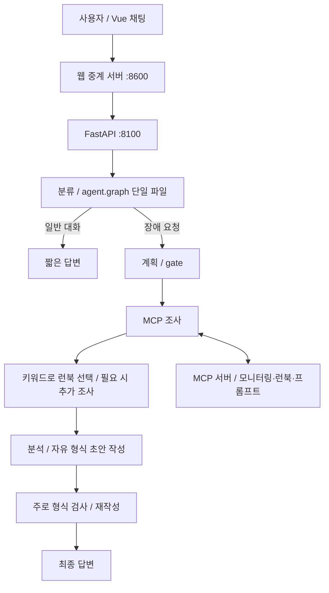
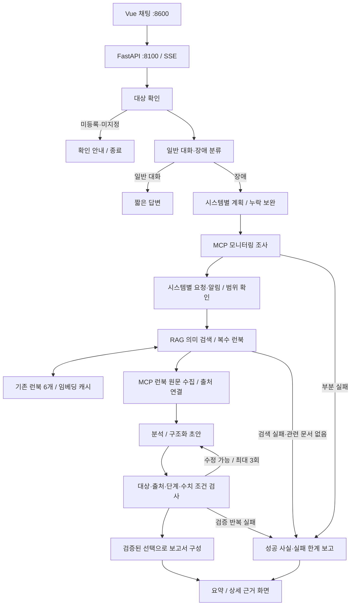
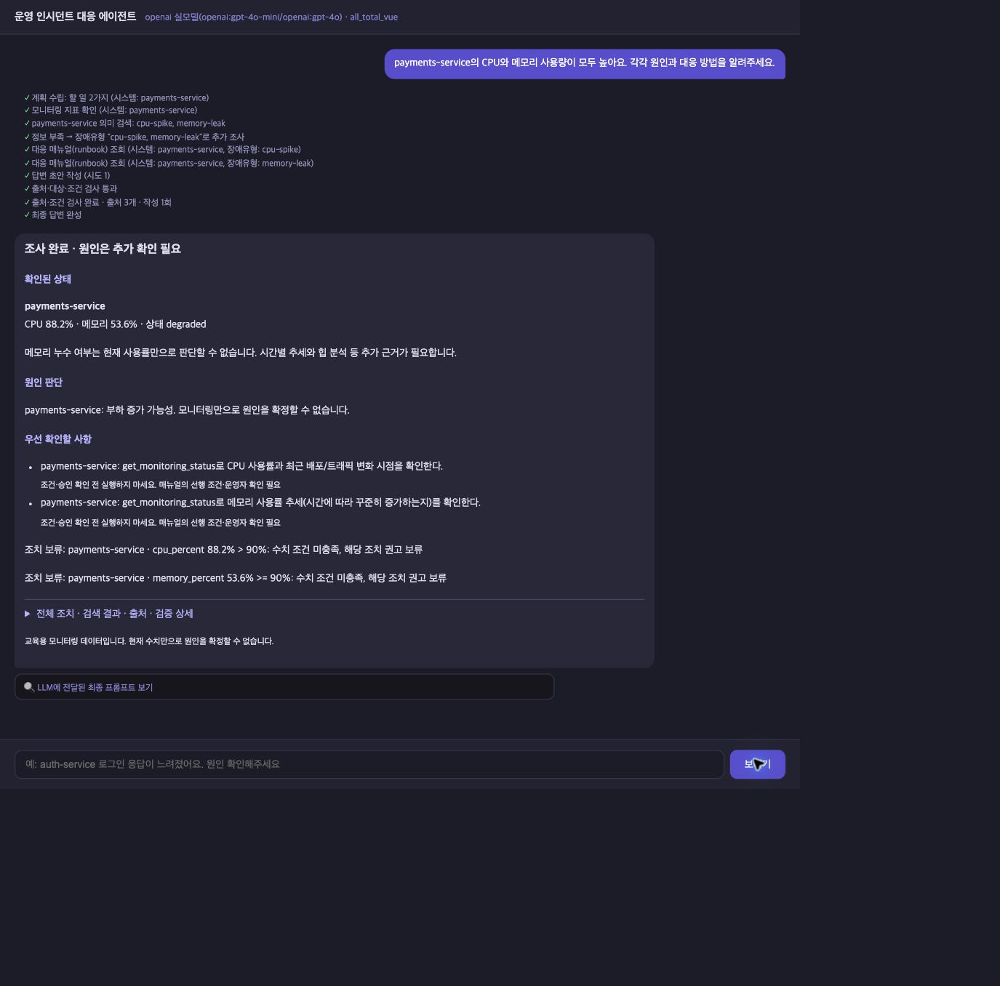
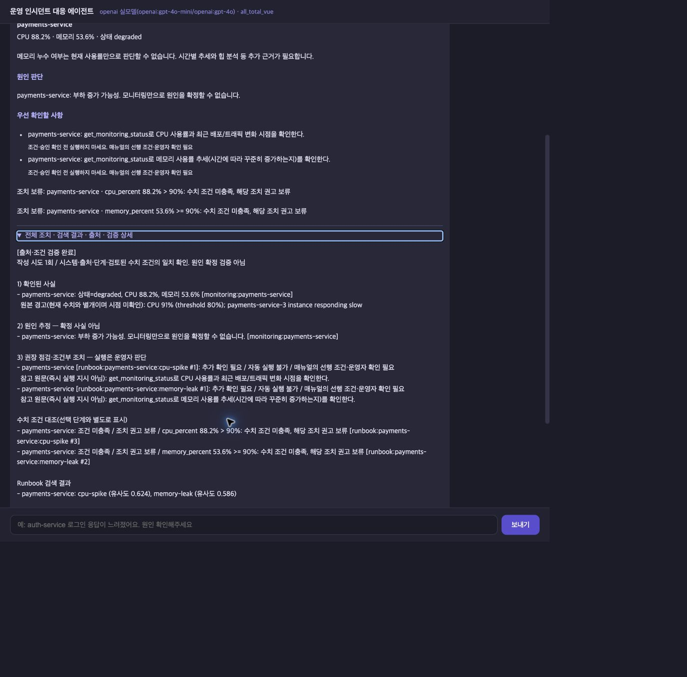
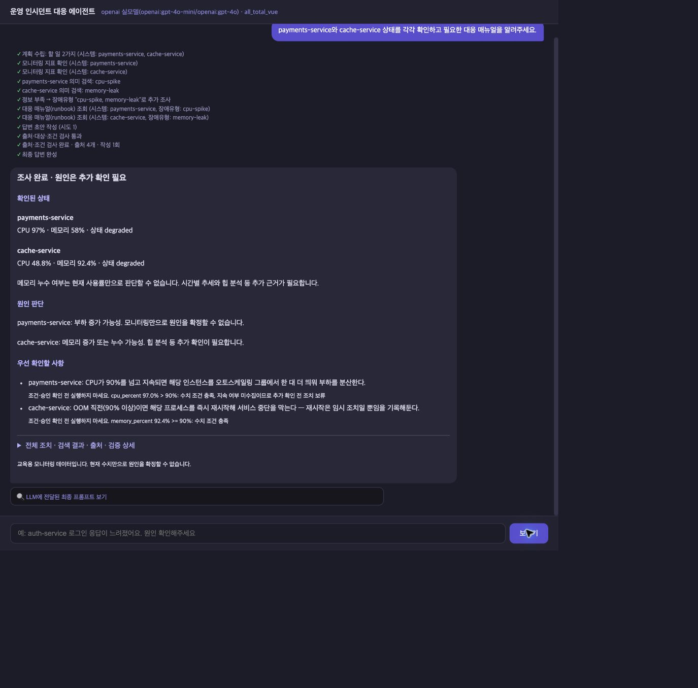
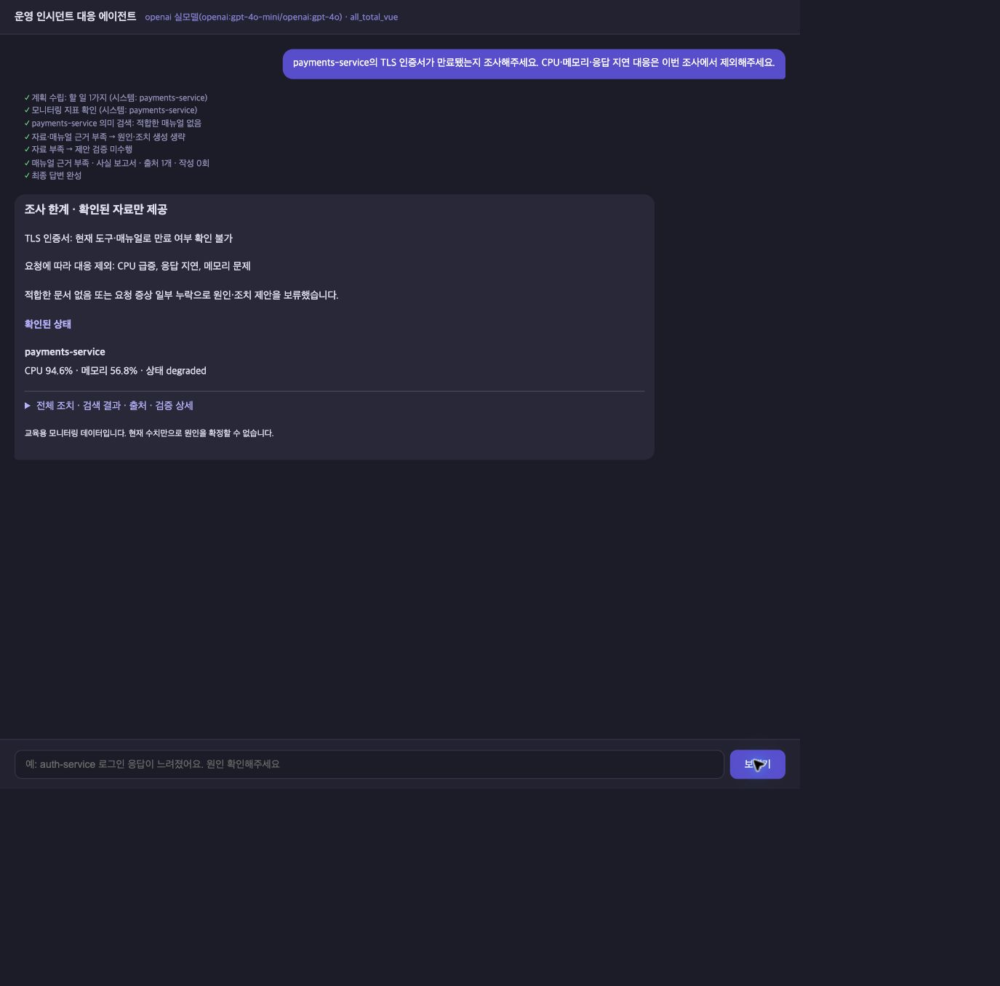
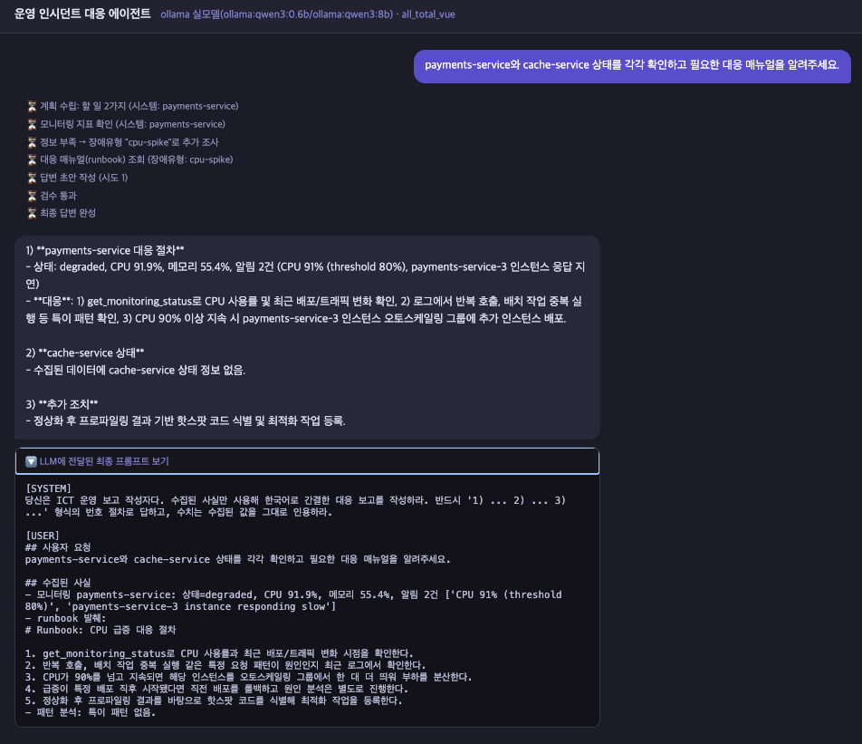

G073 김주오 · 과제 1 · 2026-10-21

# 운영 인시던트 대응 에이전트 개선 보고서

## 1. 과제 소개와 진행 결과

서비스에 장애가 생기면 담당자는 **어느 서비스를 조사할지 정하고, 상태를 확인하고, 대응 매뉴얼을 찾아 조치 조건을 확인**해야 한다. 이 프로젝트는 그 과정을 채팅으로 도와주는 교육용 에이전트다. 사용자가 “payments-service의 CPU와 메모리가 높아요”라고 물으면 상태와 관련 매뉴얼을 모아 근거가 있는 보고서를 보여준다. 실제 서버를 재시작하거나 설정을 변경하는 도구는 실행하지 않는다.

제공된 `all_total_vue_student`를 기반으로 **조사 대상 누락, 관련 없는 매뉴얼 선택, 근거와 수치 조건이 맞지 않는 답변**을 줄이는 데 집중했다. 이 README가 실행 안내와 최종 보고서를 함께 담당한다.

### 직접 추가·개선한 핵심 기능

1. 미등록·미지정 조사 대상 확인과 임의 서비스 대체 방지.
2. 일상적인 장애 표현 분류 및 복수 시스템 조사 누락 보완.
3. 시스템별 질문·알림을 활용한 RAG 기반 복수 런북 검색.
4. 일부 조회가 실패해도 성공한 사실을 보존하는 부분 실패 대응.
5. 출처·매뉴얼 단계·수치 조건 검증과 재작성, 실패 시 확인된 사실만 제공.
6. 요약과 상세 근거를 나눈 화면, 진행 상태·지연·오류 안내.
7. 그래프 노드 모듈화와 고정 데이터 평가·단위 테스트 추가.

**최종 확인 상태:** 답변 모델 OpenAI `gpt-4o-mini / gpt-4o`, 임베딩 Ollama `embeddinggemma:latest`로 기존 질문 10개와 추가 질문 2개의 기대 동작을 확인했다. 자동 테스트는 81개 통과했다. 아래 결과는 정해진 사례의 기능 검증이며 모든 질문에 대한 정확도나 실제 장애 원인의 확정을 뜻하지 않는다.

## 2. 기존에 무엇이 문제였고 왜 바꿨는가

| 기존 제공 코드에서 확인한 문제 | 수정 이유 | 개선·추가한 방식 |
|---|---|---|
| 조사 대상이 없거나 인식하지 못하면 기본 서비스로 진행 | 다른 서비스를 조사하고도 답을 한 것처럼 보일 수 있음 | 등록된 대상인지 먼저 검사하고, 모호하거나 미등록이면 확인 안내 |
| “프로세서가 바쁘다”를 일반 대화로 분류 | 같은 장애를 다르게 표현하면 조사 자체가 생략됨 | 장애 표현을 보완해 조사 경로로 연결 |
| 두 서비스를 물어도 하나만 조회하는 경우 | 원인 관계를 판단하는 데 필요한 자료가 빠짐 | 질문의 대상 목록과 계획을 대조해 누락된 조회 추가 |
| 키워드 중심으로 매뉴얼 하나 선택 | 표현이 다르거나 복합 증상이면 자료가 부족함 | 의미 검색으로 증상별 관련 문서를 수집하고, 무관련 결과는 보류 |
| 일부 도구 예외가 전체 요청 실패로 이어짐 | 이미 확보한 자료까지 사용하지 못함 | 성공 자료와 실패 목록을 함께 저장하고 진단 한계를 표시 |
| 답변 형식 위주 검사로 수치 조건 오류가 통과 | 88%인데 90% 이상일 때의 조치를 권할 수 있음 | 출처·대상·단계·검토된 수치 조건을 코드로 대조 |
| 재작성 반복 후 미검증 답변이 통과할 수 있음 | 반복 횟수가 답변 신뢰도를 대신할 수 없음 | 최대 3회 후에도 실패하면 제안을 제외하고 사실만 제공 |
| 긴 본문과 대기 화면만으로 처리 상태를 알기 어려움 | 사용자가 지연과 실패를 구별하기 어려움 | 요약/상세 분리, 진행 시간과 지연·오류 안내 |
| 그래프 구현이 한 파일에 모임 | 수정 영향과 처리 순서를 파악하기 어려움 | 노드 구현과 상태·검색·검증·보고서 공통 로직 분리 |

## 3. 사용한 기술과 구현 범위

낯선 용어는 다음처럼 이해할 수 있다. **Graph**는 작업 순서표, **MCP**는 외부 기능과 자료를 호출하는 공통 연결 방식, **Runbook(런북)**은 장애 대응 매뉴얼이다. **RAG**는 질문에 맞는 문서를 검색한 뒤 그 자료를 답변 근거로 쓰는 방식이다.

| 기술 요소 | 제공된 부분 | 직접 변경·추가한 부분 |
|---|---|---|
| LangGraph | 분류→계획→조사→작성→검증, 필요 시 재조사·재작성 | 대상 확인 분기, 노드 분리, 자료 부족·실패 시 최종 응답 정책 |
| MCP | 클라이언트, 서버 탐색, Tool·Resource·Prompt 연결 | 시스템별 조회 결과·런북 출처 연결, 실패 결과 보존 |
| RAG | 키워드 기반 장애 유형·런북 선택 | 로컬 임베딩 검색, 복수 문서, 요청 범위·제외 조건, 검색 실패 처리 |
| 의존성 주입 | `SupervisorDeps`로 LLM·MCP 등 전달 | 검색기를 주입하고 테스트에서 가짜 구현으로 교체 |
| 모듈화 | 공통 모델·클라이언트 등 | `agent/nodes/`, `state.py`, 대상·계획·검색·근거·보고서 모듈 분리 |
| LangSmith | 실행 추적 연동 | 분리된 노드의 추적을 유지해 조회·작성·검증 경로 확인 |
| 테스트·평가 | 기본 평가 코드 | 대상·범위·검색·조건·부분 실패·JSON 출력 등 회귀 테스트와 고정 자료 평가 |
| Vue 3·SSE | 웹 채팅과 서버 이벤트 스트리밍 | 보고서 요약/상세, 출처·조건 표시, 지연·오류 안내 |
| SQLite·모델 교체 | 세션 저장, fake/ollama/openai, v1 경로 | 기존 기능 유지. 새로 구현한 성과로 계산하지 않음 |

**Multi-Agent 범위:** 여러 역할의 노드가 협력하는 그래프를 사용한다. 로그·메트릭·런북 전문 에이전트를 각각 별도 서브그래프로 구성한 확장은 구현하지 않았다. 검증도 LLM-as-a-Judge가 아니라 코드 기반 계약·근거 검사다. 운영자 확인 안내는 있지만 LangGraph `interrupt`를 이용한 승인 기능은 없다.

## 4. 기존 아키텍처와 개선 후 아키텍처

### 기존 제공 구조



웹 서버는 화면과 요청 전달을 맡고, 에이전트 서버는 작업을 진행한다. 기존에도 조사·재작성 기능은 있었지만, 대상과 내용의 정확성을 충분히 확인하지 못했다.

### 개선 후 구조



두 구조 모두 MCP를 사용한다. 새로 바뀐 핵심은 **어떤 대상을 조사했는지, 어떤 문서에 근거했는지, 그 조치의 조건이 맞는지**를 보고서까지 연결한 것이다. 기존 런북 6개 원문은 검색을 위해 고쳐 쓰지 않았다.

## 5. 파일 구조와 핵심 코드 흐름

```text
README.md                    통합 프로젝트 보고서·실행 안내
server.py                    API·SSE (개선: 보고서·오류 이벤트)
web_demo_server.py           화면 제공·8100 서버로 요청 전달
web_chat.html                Vue 화면 (개선: 요약·상세·처리 상태)
agent/
  graph.py                   그래프 연결 (개선: 노드 구현 분리)
  state.py                   요청 상태 (분리·확장)
  nodes/                     분리한 노드와 개선 로직
    targeting.py             대상 확인
    routing.py               대화/장애 분류
    planning.py              계획·gate
    research.py              MCP 조사·런북 수집·부분 실패
    analysis.py              분석
    writing.py               작성·검증·최종 응답
  targets.py / routing.py / planning.py   대상·분류·계획 보완
  runbook_search.py          RAG 검색 (추가)
  evidence.py                근거·조건 검사 (추가)
  reporting.py               구조화 보고서 (추가)
  deps.py / mcp_client.py    의존성 주입·MCP 연결 기반
  supervisor_v1.py           제공된 이전 실행 경로
  *_llm.py                   모델별 구현·OpenAI JSON 지정 개선
  session_store.py           제공된 대화 저장 기반
mcp_server.py / mcp_server_docs.py  제공된 MCP 서버
data/action_policies.json     검토된 조치 조건 (추가)
data/runbooks/              기존 장애 대응 매뉴얼 6개 (실행에 필요)
tests/                      단위·통합 회귀 검사
evaluation/                 고정 질문·데이터·평가 실행 코드
docs/before/                개선 전 Ollama 증거
docs/after/                 단계별 개선 후 Ollama 증거
docs/evaluation/            자동 평가 원본
docs/final_validation/  최종 OpenAI 캡처·결과표
```

폴더와 실제 파일 이름의 상세 목록은 저장소에서 확인할 수 있다. `nodes/planning.py`는 그래프에서 실행하는 단계이고 `agent/planning.py`는 그 단계가 사용하는 보완 함수다. 이름이 비슷해도 역할이 달라 삭제 대상이 아니다.

### 질문 하나가 처리되는 순서

예: “payments-service의 CPU와 메모리 사용량이 모두 높아요.”

1. [`graph.py`](agent/graph.py)가 노드 실행 순서를 정하고 [`state.py`](agent/state.py)에 요청·결과를 전달한다.
2. [`targeting.py`](agent/nodes/targeting.py)와 [`targets.py`](agent/targets.py)가 payments-service가 등록된 대상인지 확인한다.
3. [`routing.py`](agent/nodes/routing.py)가 장애 요청으로 보내고 [`planning.py`](agent/nodes/planning.py)가 조사 계획을 세운다. [계획 보완 함수](agent/planning.py)는 필요한 대상이 빠졌는지 검사한다.
4. [`research.py`](agent/nodes/research.py)가 [MCP 클라이언트](agent/mcp_client.py)로 상태를 조회한다. Tool은 기능 호출, Resource는 매뉴얼 원문, Prompt는 제공된 작업 지침을 가져오는 역할이다.
5. [`runbook_search.py`](agent/runbook_search.py)가 질문과 알림에 맞는 CPU·메모리 런북을 찾는다. 검색 결과를 답변에 바로 쓰는 것이 아니라 실제 원문과 출처를 수집한다.
6. [`writing.py`](agent/nodes/writing.py)가 모델에 구조화된 초안을 요청하고 [`evidence.py`](agent/evidence.py)가 실제 수집 자료와 대조한다.
7. [`reporting.py`](agent/reporting.py)가 확인된 수치·원문·검사 결과를 보고서로 만들고 [`web_chat.html`](web_chat.html)이 요약과 상세로 보여준다.

### 중요한 코드의 의미

[`graph.py`](agent/graph.py)의 의존성 주입 연결:

```python
node = lambda fn: partial(fn, deps=deps)
g.add_node("research", node(research_node))
g.add_node("write", node(write_node))
g.add_node("validate", node(validate_node))
```

조사·작성 함수가 사용할 도구를 안에서 직접 만들지 않고 `deps`로 전달한다. 시험할 때 실제 API 대신 고정 답을 주는 구현을 넣을 수 있다. 이 연결 방식은 제공된 기반을 유지했다.

[`research.py`](agent/nodes/research.py)의 부분 실패 처리는 여러 작업의 결과를 모을 때 예외도 결과로 받아 분리하는 방식이다.

```python
# 핵심 방식의 축약 예시
results = await asyncio.gather(*tasks, return_exceptions=True)
# 성공 결과는 근거로 저장하고, 예외는 실패 목록으로 저장한다.
```

한 서비스 조회 실패가 다른 서비스의 성공 자료까지 없애지 않게 한다. MCP 클라이언트 내부 잠금이 있어 실제 도구 호출 전체가 병렬화됐다는 의미는 아니다.

[`runbook_search.py`](agent/runbook_search.py)의 검색 흐름을 쉽게 표현하면 다음과 같다.

```text
기존 문서 6개 → 임베딩(의미를 나타내는 숫자) → 로컬 캐시
시스템별 질문·알림 → 포함/제외 범위 확인 → 임베딩 비교
→ 관련도 기준을 통과한 문서 → MCP 원문 조회 → 답변 근거
```

벡터 DB 서비스를 별도로 설치하지 않고 원문 문서 단위로 검색한다. 기본 유사도 기준은 0.43, 후보 간 점수 범위는 0.08, 증상별 최대 2개다. 여러 증상의 검색 결과를 합치면 전체 문서 수는 2개를 넘을 수 있다. 문서·모델 정보로 캐시 변경 여부를 판단한다. 질문 범위 처리는 제한된 표현 규칙과 의미 검색을 함께 사용하는 방식이다.

[`evidence.py`](agent/evidence.py)와 [`action_policies.json`](data/action_policies.json)의 핵심은 **수치 조건과 실행 허가를 구분**하는 것이다.

```text
메모리 56.7% >= 매뉴얼 재시작 기준 90% → 조건 미충족 / 권고 보류
CPU 94% > 90% → 수치만 충족 / 지속 여부를 몰라 추가 확인 필요
출처·단계가 없거나 계약을 어긴 초안 → 반려·재작성
3회 후에도 실패 → 원인·조치 제안을 빼고 확인된 사실만 출력
```

검토된 수치 정책은 CPU 증설과 메모리 재시작의 두 조건이다. 다른 모든 매뉴얼 문장을 자동으로 해석·검증하는 기능은 아니다. 최종 수치와 매뉴얼 원문은 Python 코드가 근거에서 가져오므로 모델이 마음대로 바꾼 숫자를 그대로 표시하지 않는다. OpenAI 작성 호출에는 JSON 출력 모드를 연결했으며 별도의 출처·조건 검사는 계속 수행한다.

## 6. 구현 화면과 최종 실행 결과

**최종 캡처는 OpenAI 답변 모델 + Ollama 임베딩 환경이다.** 요약 화면의 “검증 완료”는 출처·대상·단계와 검토된 조건을 확인했다는 뜻이며 실제 장애 원인을 확정했다는 뜻이 아니다.

### 복합 증상: CPU와 메모리 런북을 함께 사용





메모리 누수는 단일 시점 사용률만으로 확정하지 않는다. 조치의 조건이 맞지 않으면 보류하고 추가 확인 필요를 안내한다.

### 여러 시스템: 각각 조사하고 근거 연결



### 관련 문서 없음과 제외 요청



TLS 인증서 질문은 원래 10개 질문을 대체한 것이 아니라, **관련 문서가 없을 때 엉뚱한 런북을 제공하지 않는지** 확인하려고 추가한 A2 사례다. 현재 도구로 만료 여부를 확인할 수 없음을 알리고 제외한 CPU·메모리·지연 조치를 제안하지 않는다.

## 7. 검증 기준과 결과

### 7.1 최종 OpenAI 기능 검증

기존 질문은 원문을 유지하고 매번 독립 대화로 실행했다. 01~08은 필요한 대상·자료 수집과 보고서 검사, 09는 미등록 대상 안내, 10은 도구 없는 대화가 기준이다.

|번호|질문|기대 런북/동작|결과·캡처|
|---|---|---|---|
|01|payments-service CPU 사용률이 급증했어요. 원인과 대응 방법을 알려주세요.|cpu-spike|[통과](docs/final_validation/captures/01_요약.png)|
|02|payments-service에서 프로세서가 계속 바쁘고 처리가 밀려요. 현재 상태와 대응 방법을 알려주세요.|cpu-spike|[통과](docs/final_validation/captures/02_요약.png)|
|03|cache-service 메모리 사용량이 계속 늘어나요. 원인과 대응 방법을 알려주세요.|memory-leak|[통과](docs/final_validation/captures/03_요약.png)|
|04|cache-service가 시간이 지날수록 메모리를 더 먹고 있어요. 점검 방법을 알려주세요.|memory-leak|[통과](docs/final_validation/captures/04_요약.png)|
|05|log-service 로그를 저장할 공간이 부족해요. 현재 상태와 대응 방법을 알려주세요.|disk-full|[통과](docs/final_validation/captures/05_요약.png)|
|06|gateway-service에서 payments-service로 가는 요청이 타임아웃 나고 있어요. 원인과 대응 방법을 알려주세요.|network-timeout|[통과](docs/final_validation/captures/06_요약.png)|
|07|auth-service 로그인 응답이 느려요. 현재 상태와 대응 방법을 알려주세요.|high-latency|[통과](docs/final_validation/captures/07_요약.png)|
|08|payments-service와 cache-service 상태를 각각 확인하고 필요한 대응 매뉴얼을 알려주세요.|cpu-spike, memory-leak|[통과](docs/final_validation/captures/08_요약.png)|
|09|billing-service 응답이 느려요. 원인 확인해주세요.|미등록 대상 확인|[통과](docs/final_validation/captures/09_요약.png)|
|10|안녕, 너는 누구야?|일반 대화, 도구 조회 없음|[통과](docs/final_validation/captures/10_요약.png)|

추가 사례는 별도로 집계했다.

| 번호 | 추가 질문 | 기대 동작 | 확인 |
|---|---|---|---|
| A1 | payments-service의 CPU와 메모리 사용량이 모두 높아요. 각각 원인과 대응 방법을 알려주세요. | 두 증상 런북·출처와 조건 구분 | [통과](docs/final_validation/captures/A1_요약.png) |
| A2 | payments-service의 TLS 인증서가 만료됐는지 조사해주세요. CPU·메모리·응답 지연 대응은 이번 조사에서 제외해주세요. | 미지원 안내·제외 범위 준수 | [통과](docs/final_validation/captures/A2_요약.png) |

- 최종: **기존 10/10, 추가 2/2의 기대 동작 확인**. 검색 일반화 정확도 100%라는 뜻이 아니다.
- 1차 OpenAI 실행은 기존 8/10이었다. 06·08에서 시스템별 문장 분리로 공통 질문이 사라지는 문제를 발견해 수정하고 재검증했다. 초기 실패 기록을 최종 성공으로 덮어쓰지 않았다.
- 자동 테스트 **81개 통과**: 대상·복수 조사·요청 범위·검색·부분 실패·수치 경계·근거·보고서·스트림 오류·OpenAI JSON 호출 등.
- [최종 결과 JSON](docs/final_validation/검증결과.json), [결과표 CSV](docs/final_validation/검증결과표.csv), [1차 진단 기록](docs/final_validation/수정전_진단기록.json). 캡처 폴더에는 화면 텍스트도 함께 있다.

### 7.2 같은 질문의 개선 전후 비교 — Ollama끼리 비교

답변 모델은 전후 모두 `qwen3:0.6b / qwen3:8b`다. 기준 버전은 개선 전 `2c2973d`, 1차 개선 후 `f3836e2`다. **최종 OpenAI 결과와 섞어서 개선율을 계산하지 않는다.**

| 측정 항목 | 개선 전 | 1차 개선 후 | 해석 |
|---|---:|---:|---|
| 06·08 두 질문에서 실제 조회한 요청 대상 수 / 요청 대상 합계 | 2/4 (50%) | 4/4 (100%) | 조사 대상 포함률 +50%p |
| 같은 두 질문에서 누락한 조사 대상 수 | 2개 | 0개 | 누락 2개 감소 |
| 02 일상 표현 질문의 장애 조사 경로 진입 | 0/1 | 1/1 | 해당 사례의 일반 대화 오분류 해소 |
| 09 미등록 시스템의 임의 기본 서비스 대체 | 1/1 | 0/1 | 해당 사례의 잘못된 대체 조사 차단 |

06은 gateway·payments, 08은 payments·cache를 각각 요청하므로 총 4개의 조사 대상이다. 이 계산은 **두 사례의 대상 포함률**이며 전체 답변 정확도나 RAG 검색 성능 향상률이 아니다. 08·09 개선 전 자료는 사용자가 교체한 완료 캡처와 수동 전사 기록을 기준으로 했다.

**같은 08번 입력의 전후 화면:**




추가 비교 증거: [06 개선 전](docs/before/06_게이트웨이타임아웃.png) / [06 개선 후](docs/after/06_네트워크_완료.jpg), [02 개선 전](docs/before/02_CPU다른표현_일반대화오분류.png) / [02 개선 후](<docs/after/02_다른 표현_완료.jpg>), [09 개선 전](docs/before/09_미등록시스템_auth로대체_완료.png) / [09 개선 후](<docs/after/09_미등록 시스템_완료.jpg>).

**조건 검증은 별도의 후속 개선이다.** 1차 개선 후에도 06에서 CPU 88.4%를 90% 초과로 판단하는 오류가 남았다. 근거 계약·조건 검사 개선 버전 `4d518cb`에서 04·06을 재검증했고, 06은 CPU 90.3%여도 지속 여부를 확인하지 못해 조치를 보류했다. 전후 현재 수치가 달라 이 두 캡처만으로 조건 정확도 개선율을 계산하지 않는다. 낮은 값과 경계값은 고정 데이터 테스트로 확인한다.


원본: [개선 전 질문·기록](docs/before/화면기록.json), [1차 개선 후 기록](docs/after/화면기록.json), [후속 04](docs/after/v2_grounded/04_화면내용.txt), [후속 06](docs/after/v2_grounded/06_화면내용.txt).

### 7.3 자동 평가와 측정 한계

[`evaluation/run.py`](evaluation/run.py)는 동일한 고정 질문·모니터링·매뉴얼을 이용해 Git 버전별 동작을 비교한다. 실제 API 대신 fake/mock을 사용하는 평가이므로 실모델 정확도·속도 측정과 구분한다. [과거 비교 집계](docs/evaluation/comparison.json)와 [CSV](docs/evaluation/comparison.csv)는 당시 버전의 기록이다.

[`evaluation/run_retrieval.py`](evaluation/run_retrieval.py)와 [`rag_cases.json`](evaluation/rag_cases.json)은 검색 결과를 기대 문서와 비교한다. 보관된 초기 검색 평가의 보류 자료 9개는 기대 문서 집합 완전 일치 6/9였다. 이후 요청 범위·검색 로직이 바뀌었으므로 이 숫자를 최신 검색 정확도라고 표기하지 않는다. [초기 검색 결과](docs/evaluation/rag_retrieval.json), [범위 처리 평가](docs/evaluation/rag_scope_retrieval_20261021.json), [부분 실패 평가](docs/evaluation/partial_failure.json)를 보존했다.

모니터링 현재 수치는 교육용 샘플에 변동이 있고 고정 알림의 발생 시점도 확인할 수 없다. 자동화 중 화면 관측 시간에는 작업 사이 대기가 포함돼 실제 처리 지연으로 사용하지 않았다. 비용 필드는 가상 단가 환산이므로 실제 청구액이 아니다. 따라서 **지연·비용 감소율은 주장하지 않는다.**

## 8. 실행과 직접 확인하는 방법

프로젝트 폴더에서 Python 3.11 환경을 사용한다.

```bash
python3 -m venv .venv
source .venv/bin/activate
pip install -r requirements.txt
# .env가 없을 때만 예제를 복사하고 본인 키를 설정한다.
cp .env.example .env
```

`.env`에 OpenAI 키와 필요 시 LangSmith 추적 키를 설정한다. 실제 키·세션 DB·임베딩 캐시는 Git에 올리지 않는다. OpenAI 답변을 사용하더라도 현재 RAG 임베딩은 로컬 Ollama가 담당한다.

```bash
# Ollama가 실행 중이어야 한다. 로컬 모델이 없으면 설치한다.
ollama pull embeddinggemma
# 터미널 1: 최종 발표와 같은 OpenAI 백엔드
bash sh/run_agent_openai.sh
# 터미널 2: 같은 프로젝트·가상환경에서 웹 화면
bash sh/run_frontend.sh
```

브라우저에서 `http://localhost:8600/`을 연다. 서버 상태는 `http://localhost:8100/health`에서 확인한다. 헤더가 `openai:gpt-4o-mini / openai:gpt-4o`인지 확인한 뒤 7절 질문을 입력한다. 상세 근거를 펼쳐 시스템별 조회, 런북, 수치 조건과 작성 횟수를 확인한다.

실행 스크립트는 기존 8100 프로세스를 정리하고 `session.db`를 삭제한다. 제공된 SQLite 저장 기능과 별개로 이 스크립트를 재실행하면 이전 대화가 보존되지 않는다. 화면 새로고침도 새 대화 ID를 생성하므로 과거 대화 자동 복원 기능은 없다. 코드 수정 후에는 백엔드를 재시작하고 화면을 새로고침한다.

Ollama 답변 비교용 실행은 `bash sh/run_agent_ollma.sh`다. OpenAI 실행과 동시에 같은 8100 포트에 켜지 않는다. 기본 RAG 설정은 `.env.example`을 참고한다. `RUNBOOK_SEARCH_MODE=keyword`는 이전 방식 비교를 위한 별도 모드이며 검색 실패 시 자동 대체 경로가 아니다.

네트워크 없는 회귀 검사:

```bash
LANGCHAIN_TRACING_V2=false .venv/bin/python -m unittest discover -s tests -q
```

LangSmith에서는 사용한 프로젝트의 Tracing에서 입력 질문이 같은 실행을 열고, 노드별 입력·출력, MCP 조회 대상, 작성·검증 반복을 확인한다. 초록색 실행 성공은 예외 없이 끝났다는 뜻으로, 내용의 정답 판정과 구분한다. 전후 지연을 비교하려면 같은 모델·입력·고정 데이터로 별도 반복 측정해야 한다.

## 9. 회고와 이후 개선할 점

이번 작업에서 확인한 핵심은 **답변이 끝까지 나오는 것과 내용이 맞는 것은 다르다**는 점이다. 두 시스템 조사가 성공해도 수치 조건을 잘못 적용할 수 있었고, 검색 결과가 있어도 사용자 요청에서 제외한 문서일 수 있었다. 그래서 조사 대상, 문서의 관련성, 조치 조건을 각각 검사하고 실패 결과도 보고서에 드러내도록 바꿨다.

기능을 더 늘리기보다 다음 항목을 우선 개선할 필요가 있다.

1. **검색 평가 확대:** 고정된 평가 자료를 개발용·검증용으로 나누고 새로운 표현·관련 문서 없음·복합 제외 지시를 평가한다. 현재 규칙 기반 범위 추출은 복잡한 표현을 놓칠 수 있다.
2. **실제 진단 자료 보강:** 시계열·로그·배포 이력이 없어서 원인을 확정할 수 없다. 교육용 현재 지표와 알림만으로 추정을 확대하지 않는다.
3. **조건 정책 확장:** 현재 검토된 두 수치 정책 외 매뉴얼 조건을 명시적으로 검토·추가하고 문서 변경 시 다시 시험한다.
4. **비동기·실행 제어:** 동기 fast LLM 호출과 MCP 잠금의 대기를 개선한다. 현재 서버 제한 시간은 이벤트 루프를 막는 모든 호출을 강제로 끝내는 기능이 아니다. 큐·취소·재접속 복원은 미구현이다.
5. **상태·분석 정리:** 대상 확인 후 원래 질문으로 이어지는 대화, 세션 자동 복원을 추가한다. 분석 요약은 최종 근거 계약에서 충분히 활용되지 않아 연결하거나 단순화할 여지가 있다.
6. **실측 평가:** 동일 모델과 고정 자료로 반복 실행해 중앙 지연시간, 재작성 횟수, 토큰과 실제 비용을 기록한다. 필요할 때 전문 서브그래프·운영자 승인 단계를 추가한다.

## 10. 제출 자료와 문서 정리 기준

- **보고서:** 이 `README.md` 한 파일.
- **검증 근거:** `docs/before/`, `docs/after/`, `docs/evaluation/`, `docs/final_validation/captures/`의 원본·결과표는 그대로 보존한다. 과거 평가와 최신 결과는 버전·모델을 구분해 사용한다.
- **실행 데이터:** `data/runbooks/*.md` 6개는 보고서가 아니라 검색 대상 매뉴얼이므로 유지한다.

분산된 README·프로젝트 보고서·코드 설명은 이 문서에 통합했다. 제공된 사용 설명서·예시 이미지는 이력 참고용으로 보존한다. 발표용 PPTX·PDF·대본은 데스크탑에 별도로 보관하며 저장소에 포함하지 않는다. 삭제된 과거 문서는 Git 이력에서 확인할 수 있다.
