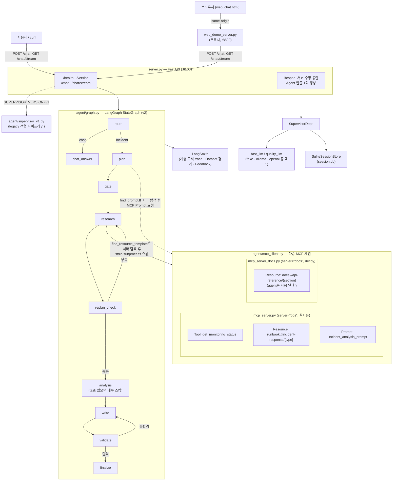
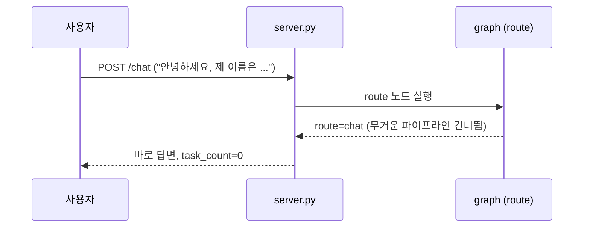
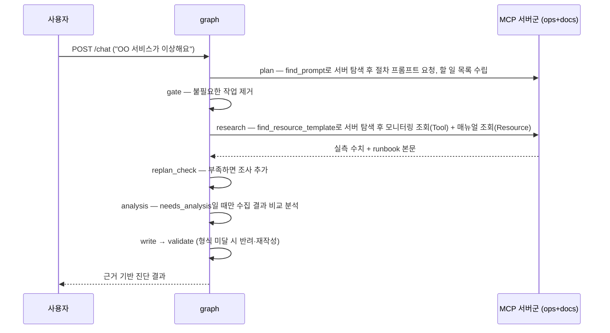
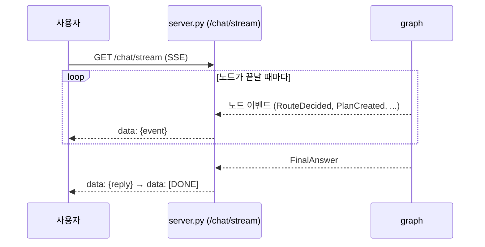
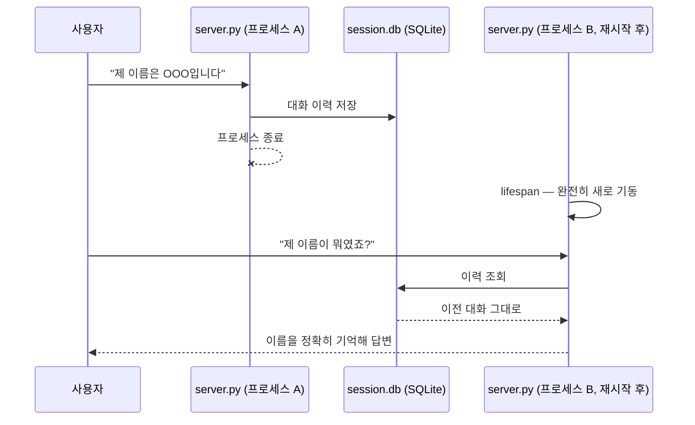
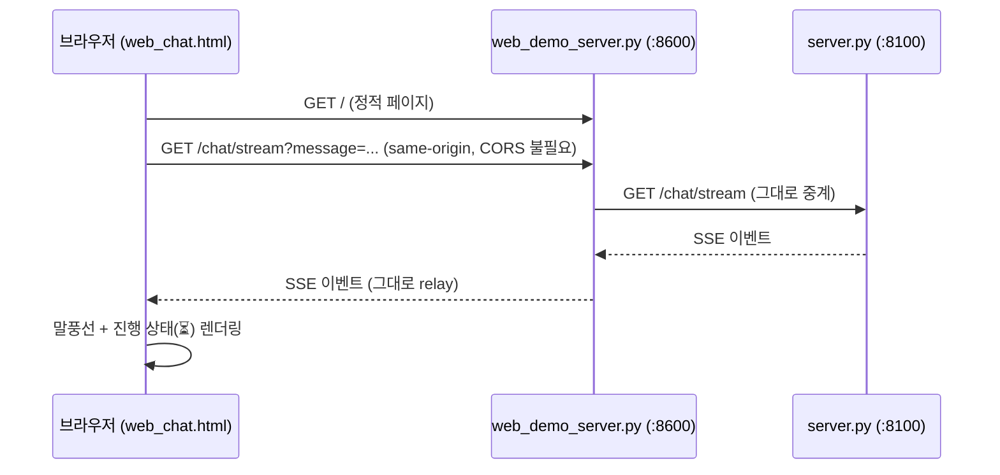

# 작업 인계 메모 — 2026-10-20

현재까지의 변경을 집에서 이어서 정리하기 위한 기록이다. **RAG는 구현·자동 검증 단계이며 최종 실모델/Vue 검증 완료 상태가 아니다.** 아래 원본 교육 매뉴얼은 현재 개선 코드와 차이가 있으므로 최신 구현은 [통합 프로젝트 보고서](../docs/프로젝트_보고서.md)를 기준으로 확인한다.

## 지금까지 완료한 개선

1. 미등록·미지정 조사 대상 확인과 임의 기본 시스템 대체 방지.
2. 일상 장애 표현의 질문 분류 보완.
3. 복수 시스템 조사 계획 누락 보완과 시스템별 매뉴얼 연결.
4. Python 기반 CPU/메모리 수치·조치 조건 검사, 출처·단계 검증 및 최대 3회 재작성.
5. 사실·원인 추정·조건부 조치·출처를 구분한 보고서, 검증 실패 시 사실만 제공.
6. `agent/nodes/`에 Graph 노드 역할별 분리, `agent/state.py`에 공유 상태 분리.
7. 조회 작업별 부분 실패 격리와 성공 자료 보존, 실패 대상·분석 한계 안내.
8. 고정 데이터 평가 및 단위·그래프 테스트.
9. 로컬 임베딩 기반 RAG 다중 Runbook 검색 연결(아래 검증 한계 확인 필요).

## 이번 RAG 작업의 파일과 정책

- `agent/runbook_search.py`: Ollama 임베딩, 코사인 유사도 검색, 인덱스 저장·갱신, 시스템별 검색 입력.
- `agent/nodes/research.py`: 검색 결과별 MCP 매뉴얼 작업 생성, 원문 해시 대조, 검색 오류의 부분 실패 연결.
- `agent/evidence.py`: 검색된 모든 매뉴얼마다 제안 단계가 있는지 검사.
- `agent/reporting.py`, `server.py`, `web_chat.html`: 검색 문서·유사도·무결과·실패 상태 전달 및 표시.
- 기존 매뉴얼 원문 6개는 변경하지 않았다. 로컬 모델은 `embeddinggemma:latest`이며 `ollama pull embeddinggemma`로 준비한다.
- 기본 `RUNBOOK_SEARCH_MODE=rag`; `keyword`는 명시적 이전 방식 비교 모드다. RAG 오류나 무결과 때 자동 폴백하지 않는다.
- 최소 유사도 0.43, 최고 점수 차이 0.08 이내, 최대 3문서. 설정은 `.env.example` 참고.
- 재생성 가능한 인덱스는 `data/.cache/`에 저장하며 Git에서 제외했다. 실제 `.env`는 수정하거나 커밋하지 않았다.
- 적합한 문서 없음은 `insufficient`, 임베딩·검색 실패는 부분 실패로 기록한다. 자료가 부족하면 원인·조치 생성 대신 사실과 한계를 제공한다.

## 검증 결과 — 성공과 미완료 구분

- 자동 테스트 **69개 통과**(기존 55 + RAG 관련 14). 합성 벡터·mock 검사는 실제 언어 이해 성능과 구분한다.
- 실제 임베딩 검색: 개발 세트 8/8, 별도 평가 6/9 문서 집합 일치. 별도 평가의 관련 문서 없음 2/2 구분. 메모리·지연·네트워크의 일부 일상 표현은 임계값에 못 미쳐 누락됐다.
- 실제 MCP + 실제 임베딩 + **fake 분류/계획/작성** 연결 검사:
  - 단일 시스템 복합 증상에서 CPU·메모리 외 지연 매뉴얼까지 3개가 선택됐고 보고서 계약 검증은 통과했다. 검색의 의미적 적합성 전부를 보증하지 않는다.
  - payments/cache 복수 시스템에서는 payments 검색이 무결과이고 cache의 메모리 매뉴얼만 선택돼 `insufficient` 사실 보고서로 종료했다. **현재 개선해야 할 실제 검색 입력 문제**다.
- 실제 qwen3:8b 작성 검사: 첫 질문이 4분 이상 완료되지 않아 테스트 프로세스를 정상 취소했다. 답변 성공으로 기록하지 않는다. 긴 생성의 원인·설정은 추가 확인해야 한다.
- 최신 전체 질문 10개 및 복합 장애·검색 무결과·부분 실패의 Vue 재검증과 최종 캡처는 아직 미완료다.

원본 결과: [검색 평가](../docs/evaluation/rag_retrieval.json), [MCP·임베딩 연결 검사](../docs/evaluation/rag_integration.json), [8B 생성 미완료 기록](../docs/evaluation/rag_writer_check.json). 과거 `docs/after/` 캡처를 이번 RAG 최종 검증 결과로 사용하지 않는다.

## 집에서 이어서 할 순서

1. 복수 시스템에서 빈 질문 구간·서비스 이름 등이 검색에 미치는 영향을 점검하고 payments 무결과를 개선한다. 기본 매뉴얼 강제 선택으로 덮지 않는다.
2. 복합 증상에서 불필요한 매뉴얼이 포함되는지 점검한다. 정책을 바꾸면 기존 평가를 보존하고 새 결과를 구분한다.
3. qwen3:8b의 장시간 생성 원인을 확인하고 응답 시간 제한·구조화 출력·thinking 제어 등을 검토한다. 아직 해당 개선을 구현한 것으로 적지 않는다.
4. 자동 테스트와 실제 임베딩 평가를 다시 실행한다.
5. 서버를 최신 코드로 재시작하고 기존 질문 10개·복합 장애·검색 무결과·일부 실패를 실제 Vue에서 검증해 최종 캡처를 저장한다.
6. 통합 보고서의 최신 상태·평가·한계를 갱신하고 제출용 보고서/PPT를 정리한다.

```bash
PYTHONDONTWRITEBYTECODE=1 LANGCHAIN_TRACING_V2=false LANGSMITH_TRACING=false .venv/bin/python3 -m unittest discover -s tests -v
PYTHONDONTWRITEBYTECODE=1 .venv/bin/python3 evaluation/run_retrieval.py
```

기존 기동 스크립트는 포트 프로세스를 종료하거나 session.db를 초기화할 수 있으므로 대화 보존이 필요하면 먼저 확인한다. 현재 실행 중인 서버에는 미커밋 상태의 새 코드가 자동 반영됐다고 가정하지 않는다.

---

## 아래는 제공 코드의 원본 교육 매뉴얼

> 이 문서는 제공 코드의 원본 교육 매뉴얼입니다. 직접 구현한 개선·검증·한계는 [프로젝트 보고서](../docs/프로젝트_보고서.md)를 참고하세요.

# all_total_vue — 운영 인시던트 대응 에이전트 (Vue 프론트엔드 버전)

`all_total`과 백엔드(server.py, agent/, mcp_server.py 등)는 완전히 동일하고, 브라우저
채팅 화면(`web_chat.html`)만 바닐라 JS 대신 **Vue 3**(CDN 글로벌 빌드, 별도 빌드 단계
없음)로 재작성한 버전이다. 나머지 설명은 원본 `all_total`과 같다.

Wave 1~15가 각각 증명한 패턴(싱글턴·MCP·SSE·라우팅·게이트·재계획·검증·재시도·병렬·비용분리·
세션·주입·버전 토글·가드)을 전부 조립한 **실제 동작하는 에이전트 서비스**다. LLM 자리는
`fake`(결정론)/`ollama`(로컬 실모델)/`openai`(실제 API) 세 백엔드 중 아무거나 꽂을 수 있고,
요청 한 건이 처리되는 전 과정은 LangSmith에 계층 트리로 기록·평가·피드백된다.

## 주요 실행 방법

**맨 처음 한 번만**: 이 폴더를 처음 받았다면(학생 배포 등) `.venv`부터 만든다.

```bash
bash sh/setup_venv.sh
```

| 방법 | 명령 | 비용 | 용도 |
|---|---|---|---|
| Python 가상환경 준비 | `bash sh/setup_venv.sh` | 없음 | `.venv` 생성 + `requirements.txt` 설치(최초 1회, 이미 있으면 설치만 재확인) |
| 로컬 Ollama 환경 준비 | `bash sh/setup_ollama.sh` | 없음(로컬 추론) | 모델(`qwen3:0.6b`/`8b`)이 이미 있으면 재사용, 없으면 새로 pull — `OLLAMA_FORCE_REFRESH=1`을 주면 지우고 재구성 |
| 에이전트만 기동 (로컬) | `bash sh/run_agent_ollma.sh` | 없음 | 서버만 띄워두고 직접 curl/웹으로 테스트 |
| 에이전트만 기동 (OpenAI) | `bash sh/run_agent_openai.sh` | **과금** | 위와 동일하되 실제 API 사용 (y/N 확인) |
| 브라우저 채팅 화면 | `bash sh/run_frontend.sh` (서버 기동 후) | 백엔드에 따름 | `http://localhost:8600`에서 실제 채팅 UI로 사용 |

`run_agent_*.sh`/`run_frontend.sh`는 `.venv`가 이미 있다는 가정 하에 PATH에
꽂아 쓰기만 한다(`.venv`가 없으면 시스템 `python3`로 조용히 떨어져 패키지
누락 오류가 날 수 있다) — `setup_venv.sh`를 먼저 돌려야 하는 이유다.

모든 스크립트는 `.env`가 없으면 `cp .env.example .env` 후 본인 API 키를 채우라는 안내를
출력하고 종료하며(외부 경로에 의존하지 않음 — 이 폴더만 떼어가도 그대로 동작),
LangSmith 프로젝트를 백엔드별로 분리해 기록한다(`capstone-all-total[-ollama|-openai]`).

> 더 쉬운 설명과 실제 캡처 화면이 필요하면 [manual_ollma.md](manual_ollma.md)(로컬
> 실모델) · [manual_openai.md](manual_openai.md)(OpenAI API)를 참고.

## 아키텍처 구성도



- **싱글턴**: `server.py`의 `lifespan`에서 `SupervisorDeps`(LLM·세션·MCP 연결)를 정확히
  1회 생성해 `app.state`로 공유한다 — 요청마다 재생성하지 않는다.
- **백엔드 교체**: `LLM_BACKEND` 환경변수 하나로 `fake_llm.py`/`ollama_llm.py`/
  `openai_llm.py`가 바뀌어 꽂히고, 그래프·MCP·세션 코드는 전혀 바뀌지 않는다.
- **버전 토글**: `SUPERVISOR_VERSION=v1`이면 라우팅·게이트·재계획·검증이 없는 legacy
  선형 파이프라인(`supervisor_v1.py`)으로, 재배포 없이 환경변수만으로 전환된다.
- **MCP는 별도 프로세스**: `mcp_server.py`(ops)가 stdio subprocess로 떠서 서버 수명 동안
  재사용되며, 모니터링 조회(Tool)·대응 매뉴얼(Resource)·진단 절차(Prompt) 세 가지
  capability를 모두 실사용한다.
- **MCP 멀티 서버 탐색**: `mcp_client.py`는 `ops`(mcp_server.py, 실사용)·`docs`
  (mcp_server_docs.py, 내부 API 문서 Resource만 제공하는 decoy) 두 서버에 동시
  연결한다. `plan`/`research` 노드는 어느 서버가 필요한 prompt/resource를 들고
  있는지 코드에 하드코딩하지 않고, `find_prompt()`/`find_resource_template()`로
  연결된 서버들을 먼저 조회한 뒤에야 그 서버로 요청을 보낸다.
- **분석 단계 분리**: `replan_check`가 조사 결과가 충분하다고 판단하면 항상
  `analysis` 노드로 넘어가지만, gate가 살려둔 `agent=="analysis"` task가 없으면
  `analysis_node`가 내부적으로 스킵하고 바로 `write`로 넘어간다 — `needs_analysis`가
  실제로 유효한 경우에만 수집된 모니터링 결과들을 비교 분석한다.

## 주요 유스케이스별 고수준 시퀀스 다이어그램

### 1. 가벼운 대화



### 2. 장애 진단 요청



### 3. 실시간 진행 상황 스트리밍



### 4. 서버 재시작 후 대화 기억



### 5. 웹 채팅 화면 사용



## 소스 디렉토리 구조

```
all_total_vue/
├── server.py              # FastAPI 진입점 — lifespan 싱글턴, /health·/version·/chat·/chat/stream
├── mcp_server.py           # fastmcp 서버("ops") — Tool/Resource/Prompt (실사용, stdio subprocess)
├── mcp_server_docs.py       # fastmcp 서버("docs") — API 문서 Resource만 제공하는 decoy (멀티 서버 탐색 데모용)
├── web_chat.html            # 브라우저 채팅 화면 (정적 1파일)
├── web_demo_server.py       # web_chat.html 서빙 + /chat·/chat/stream·/health 프록시(:8600)
├── requirements.txt
├── .env.example
│
├── agent/
│   ├── deps.py              # SupervisorDeps 의존성 주입
│   ├── graph.py              # v2 LangGraph StateGraph (route/plan/gate/research/replan_check/analysis/write/validate/finalize)
│   ├── supervisor_v1.py      # legacy 선형 파이프라인 (버전 토글 대상)
│   ├── fake_llm.py           # LLM_BACKEND=fake — 결정론적 fast/quality 모델 (route/plan/analyze/chat/write)
│   ├── ollama_llm.py         # LLM_BACKEND=ollama — 로컬 실모델 백엔드
│   ├── openai_llm.py         # LLM_BACKEND=openai — 실제 OpenAI API 백엔드
│   ├── mcp_client.py          # MCP 멀티 서버(ops+docs) stdio 클라이언트 — find_resource_template/find_prompt로 서버 탐색 + 의도적 flaky 1회(재시도 데모)
│   ├── retry.py              # Transient 전용 backoff 재시도
│   └── session_store.py       # SQLite 세션 저장소
│
├── data/
│   ├── monitoring.json        # MCP Tool이 조회하는 모니터링 데이터
│   └── runbooks/               # MCP Resource가 조회하는 대응 매뉴얼 6종
│       ├── db-down.md
│       ├── cpu-spike.md
│       ├── disk-full.md
│       ├── high-latency.md
│       ├── memory-leak.md
│       └── network-timeout.md
│
├── sh/                        # 실행 스크립트 모음 (학생 배포용 — 내부 회귀 테스트 스크립트는 제외)
│   ├── setup_venv.sh            # .venv 생성 + requirements.txt 설치 (맨 처음 1회)
│   ├── setup_ollama.sh          # 로컬 Ollama 모델 준비 — 있으면 재사용, 없으면 pull (리셋은 OLLAMA_FORCE_REFRESH=1)
│   ├── run_agent_ollma.sh       # 에이전트만 기동 — 로컬 실모델
│   ├── run_agent_openai.sh      # 에이전트만 기동 — OpenAI API (과금)
│   ├── run_frontend.sh          # 브라우저 채팅 화면(web_demo_server.py) 기동
│   └── make_student_zip.sh      # .env 제외 + .env.example 포함한 학생 배포용 zip 생성
│
├── doc/                       # 문서
│   ├── README.md                # 이 문서
│   ├── manual_ollma.md          # 사용자 가이드 — 로컬 실모델 기준
│   ├── manual_openai.md         # 사용자 가이드 — OpenAI API 기준
│   ├── regression_test_queries.md  # 시스템명 하드코딩 수정 검증용 회귀 테스트 쿼리 목록
│   ├── image_usecase/           # manual_ollma.md 캡처 이미지
│   └── image_usecase_openai/    # manual_openai.md 캡처 이미지
```
