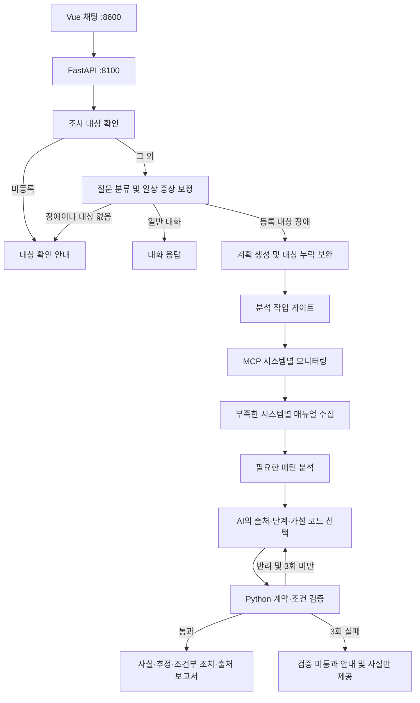
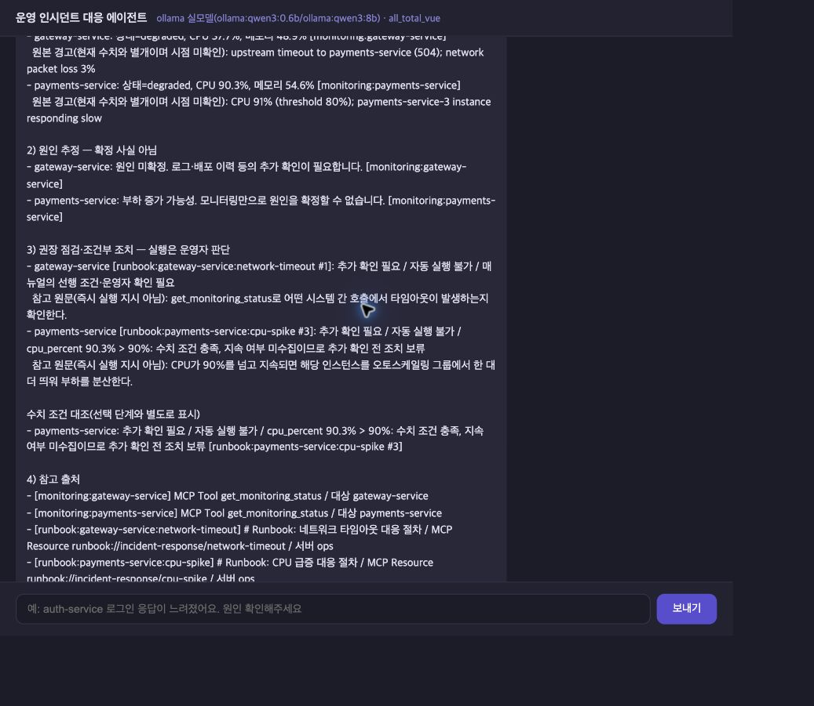

# 운영 장애 에이전트 개선 프로젝트 보고서

작성·검증 기준일: 2026-10-20
저장소: [J5-K/incident-agent-improvement](https://github.com/J5-K/incident-agent-improvement)
대상: 제공된 `all_total_vue_student`의 LangGraph v2 개선

> 이 파일이 프로젝트의 현재 상태를 관리하는 통합 문서다. 구현·평가가 바뀌면 해당 절을 갱신한다. 캡처·JSON·CSV는 당시 실행의 원본 증거로 보존하며, 이 보고서의 설명과 구분한다.

## 1. 개요와 개발 목표

운영 장애 에이전트는 사용자의 질문을 분류하고, MCP로 모니터링 정보와 대응 매뉴얼(RunBook)을 수집해 진단과 대응 방법을 안내하는 교육용 서비스다.

개선 전에는 일상적인 증상 표현을 일반 대화로 처리하거나, 여러 시스템 중 일부만 조사하거나, 미등록 시스템 대신 다른 시스템을 조사하는 문제가 관찰됐다. 첫 개선 후에는 수집된 수치가 조치 조건에 못 미치는데도 조치를 권고하는 문제가 추가로 발견됐다.

목표는 **요청한 대상을 빠짐없이 조사하고, 확인된 수치와 매뉴얼 적용 조건을 보존하며, 검증되지 않은 제안을 최종 권고로 내보내지 않는 것**이다. 실제 운영 장애의 원인을 자동 확정하거나 운영 조치를 실행하는 서비스까지 구현한 것은 아니다.

## 2. 제공 코드와 직접 구현한 내용

| 구분 | 내용 |
|---|---|
| 제공 코드 | FastAPI·LangGraph 파이프라인, Vue 3 채팅, SSE, MCP Tool·Resource·Prompt 및 서버 탐색, SQLite 대화 저장, fake/ollama/openai 백엔드, v1 전환, LangSmith 추적 |
| 직접 개선 | 미등록·미지정 대상 확인, 복수 대상 계획 보완 및 시스템별 매뉴얼 연결, 일상 증상 분류 보완 |
| 직접 추가 | 출처·단계·수치 조건 계약 검증, 사실/추정/조건부 조치 보고서, 고정 데이터 버전 비교 평가, 전후 검증 증거 |
| 적용 범위 | 기본 v2 그래프. v1은 기존 교육용 흐름을 유지 |

## 3. 구조와 처리 흐름



MCP Tool `get_monitoring_status`는 교육용 지표를 반환하고, Resource는 장애 대응 매뉴얼 원문, Prompt는 표준 조사 절차를 제공한다. 새 작업은 기존 MCP를 별도 서비스로 재구축하거나 RAG로 바꾼 것이 아니다.

모니터링 수치는 샘플 데이터에 무작위 변동을 더한다. 경고 문구는 고정되어 현재 수치와 다를 수 있다. 실제 운영 데이터·시계열·배포 이력을 수집한 것으로 해석하면 안 된다.

## 4. 문제별 개선 설계

### 4.1 조사 대상 확인

`agent/targets.py`가 `data/monitoring.json`의 등록 목록과 질문의 명시적 이름을 대조한다. 경계·대소문자를 고려하고, 유효한 대상이 없다고 기본 서비스를 반환하지 않는다. `nodes/targeting.py`의 MCP Prompt 대상 추출도 유효한 대상 없이 진행하지 않는다.

- 미등록 이름이 있으면 LLM/MCP 조사 없이 정확한 이름을 요청한다.
- 등록·미등록 이름이 섞여도 일부만 조사하지 않고 전체 확인을 요청한다.
- 대상 없는 질문이 incident로 분류되면 대상 이름을 되묻는다.
- `-service`/`_service`, `web-01` 형태 및 정확한 등록 이름을 지원한다. 별칭·대명사·이전 대화에서의 대상 복원, 모든 미등록 표기법을 지원하지 않는다.
- 등록 목록은 모듈 로드 시 읽으므로 변경 후 서버 재시작이 필요하다.

### 4.2 복수 시스템 조사와 매뉴얼 연결

`agent/planning.py`가 요청한 등록 시스템을 기준으로 모델의 계획을 보완한다. 빠진 대상을 추가하고 중복·요청하지 않은 조사 대상을 제거한다. 분석 작업은 기존 gate의 판단을 따른다.

시스템마다 모니터링과 알림을 따로 처리하고, 누락된 매뉴얼을 최대 한 번의 재조사 라운드에서 수집한다. 수집 데이터·진행 이벤트에 대상 이름을 기록하고, 매뉴얼에는 출처 ID·Resource URI·MCP 서버를 부착한다.

같은 장애의 여러 시스템도 매뉴얼을 각각 조회하므로 호출 수와 답변 길이가 늘 수 있다. 한 시스템의 복합 장애는 기존 키워드 우선순위와 `db-down` 기본값을 유지한다. RAG·암묵적 연관 시스템 탐색은 추가하지 않았다.

초기에는 최종 답변에 빠진 대상의 근거를 덧붙였지만, 현재는 구조화 계약에 전체 대상이 정확히 한 번 포함되는지 검사한다. 반복 실패 시 제안을 제외하는 방식으로 대체했다. 지표·매뉴얼 조회 실패의 부분 응답은 아직 지원하지 않는다.

### 4.3 일상적인 장애 표현 분류 보완

`agent/routing.py`가 모델의 chat 판단에 제한적인 보정 규칙을 적용한다. 등록 시스템 이름과 “프로세서가 바쁘다”, “처리가 밀린다”, “메모리를 더 먹는다” 같은 증상 또는 상태 조회 표현이 함께 있으면 incident로 승격한다.

모델의 원래 분류와 보정 이유는 `RouteDecided`에 남기고 호출 비용 누적도 유지한다. 시스템 이름만 언급한 문장이나 개념 질문은 이 규칙으로 승격하지 않는다. 정규식이므로 새로운 동의어·부정문·인용문을 완벽하게 이해하지 못하며, 대상 이름 없는 chat 오분류도 보정하지 않는다.

### 4.4 수치·조치 조건 검증

`agent/evidence.py`는 자유 서술 초안 대신 아래 항목으로 구성한 JSON 제안을 검증한다.

- 요청 시스템 이름과 모니터링 출처 ID
- 제한된 원인 가설 코드
- 실제 수집한 매뉴얼 출처 ID·단계 번호
- Python이 계산한 조건 상태

수치와 조치 원문은 코드가 수집 데이터에서 직접 출력한다. 모델이 자유 수치·문장을 추가하거나, 다른 시스템 출처·없는 단계·잘못된 조건 상태를 선택하면 반려한다. 현재 검토한 자동 수치 정책은 다음 두 가지다.

| 조치 | 코드 조건 | 경계 및 추가 조건 |
|---|---|---|
| CPU 증설, cpu-spike 3단계 | `cpu_percent > 90` | 90은 미충족. 90 초과여도 지속 여부 미수집이면 추가 확인 전 보류 |
| 메모리 재시작, memory-leak 2단계 | `memory_percent >= 90` | 90은 수치 조건 충족. 수치 충족은 실행 승인이나 실제 재시작을 뜻하지 않음 |

`data/action_policies.json`은 정책과 매뉴얼 원문 SHA-256을 연결한다. 원문이 바뀌면 정책 재검토가 필요하다고 표시한다. 값 누락·문자열·불리언·NaN·무한대는 판단 불가이며, 나머지 단계는 선행 조건과 운영자 확인이 필요하다.

작성·검증은 최대 3회다. **반복 실패를 강제 합격으로 처리하던 동작을 제거**했다. 실패 시 미검증 원인·조치를 제외하고 관측 사실·참고 출처·반려 사유만 제공한다.

### 4.5 근거가 구분된 최종 보고서

`agent/reporting.py`가 다음 순서로 최종 응답을 만든다.

1. 확인된 사실: 시스템 상태·현재 CPU·메모리와 모니터링 출처
2. 원인 추정: 제한된 가설 코드에 대응하는 가능성 문장, 원인 미확정 표시
3. 권장 점검·조건부 조치: 매뉴얼 원문, 적용 상태, 충족 여부와 추가 확인 사항
4. 참고 출처: Tool 이름, 시스템명, Resource URI·서버. 내부 JSON에는 매뉴얼 해시도 저장

고정 경고는 현재 측정값과 분리하고 시점 미확인임을 표시한다. 모델이 특정 단계를 선택하지 않아도 두 검토 정책의 수치 조건은 별도로 보여준다.

`/chat` 응답의 `metadata.report`에 구조화 보고서를 제공하고, Vue에는 검증 범위·출처 수·작성 횟수를 표시한다. 미검증 JSON 초안은 답변 토큰으로 노출하지 않고, SSE 조사·검증 진행 이벤트와 최종 보고서를 제공한다. 일반 대화의 스트리밍은 유지한다.

자유 서술의 폭은 줄지만 수치·출처·조건을 코드로 보존할 수 있다. 이 검증이 원인 가설의 진실성을 보증하거나 LLM-as-a-Judge를 대신하는 것은 아니다.

### 4.6 Graph 노드 모듈 분리

기존 `graph.py` 한 파일에 모여 있던 노드 함수를 `agent/nodes/` 아래 역할별 모듈로 이동했다. `graph.py`는 그래프 생성·의존성 주입·노드 간 연결과 분기만 담당하며 391줄에서 70줄로 줄었다.

| 모듈 | 담당 노드·기능 |
|---|---|
| `nodes/targeting.py` | 등록 대상 확인, 대상 확인 질문, 계획용 대상 추출 |
| `nodes/routing.py` | 질문 분류·보정, 일반 대화 응답 |
| `nodes/planning.py` | 조사 계획 보완, 분석 작업 게이트 |
| `nodes/research.py` | MCP 조사, 키워드 장애 유형 선택, 시스템별 매뉴얼 재조사 |
| `nodes/analysis.py` | 필요한 경우 패턴 분석 |
| `nodes/writing.py` | AI 제안 작성, 검증, 최종 보고서 생성 |
| `state.py` | 공유 AgentState와 비용 누적 함수 |

노드 이름·조건 분기·호출 순서·LangSmith 추적 이름·SupervisorDeps 주입은 유지한다. 기존 `agent.graph`에서 가져오던 노드와 대상 추출 함수도 재노출해 서버·테스트의 import를 유지했다. 전문 서브그래프나 새로운 멀티 에이전트를 구현한 것이 아니라 **기존 노드 구현의 모듈화**다.

이동 전후 20개 함수·상태 클래스의 AST(코드 구문 구조)를 비교했고, 기존 46개 자동 테스트가 통과했다. 분리 전 커밋과 분리 후 작업 트리에 고정 시나리오 15개를 실행해 답변·구조화 보고서·진행 이벤트·도구 호출·판정이 동일한지 확인했다(실행 시간 제외). 실제 모델 재검증을 추가 실행한 결과는 아니다.

## 5. 검증 방법과 판정 기준

| 검증 | 범위 | 해석 |
|---|---|---|
| 단위·그래프 테스트 | 대상 추출, 계획 보완, 분류, 조건 경계, 계약 오류, 반복 실패, 보고서·집계 | 네트워크 없는 회귀 검사 46개 통과 |
| 1차 실제 Vue 검증 | f3836e2, 기존 질문 10개, 실제 Ollama | 10개 최종 답변 확보. 실행 완료와 의미적 정확성은 별개 |
| 최신 실제 Vue 검증 | 4d518cb, 오류가 있었던 04·06 재검증 | 새 계약과 보고서 동작 확인. 전체 10개 최신 모델 정확도 평가가 아님 |
| 고정 데이터 자동 평가 | 3개 Git 버전, 고정 질문·지표·매뉴얼 15개 | fake/mock 그래프 비교. 실제 모델 정확도·지연시간 개선율이 아님 |

테스트 통과는 명시된 규칙과 시나리오의 통과다. AI 답변 전체·원인 추정·실제 운영 조치의 정확성을 보증하지 않는다. OpenAI 실 API 백엔드는 이번 실제 모델 검증에 사용하지 않았다.

### 5.1 개선 전·1차 개선 후 사례

개선 전은 기준 `2c2973d`, 1차 개선 후는 `f3836e2`다. 개선 전 01·10은 사용자 제공 캡처, 08·09는 사용자가 교체한 완료 캡처이며 나머지는 Vue에서 수집했다. 08·09 전사 기록을 새로운 자동 원시 로그로 가장하지 않았다.

| 번호 | 질문 요지 | 개선 전 | 1차 개선 후 |
|---|---|---|---|
| 01 | payments CPU 급증 | CPU 매뉴얼 조회·응답 | 동일 조사 경로 완료 |
| 02 | 프로세서가 바쁘고 처리 밀림 | 일반 대화 오분류 | CPU 조사·매뉴얼 연결. 단계 인용 등 품질 한계 있음 |
| 03 | cache 메모리 증가 | 메모리 매뉴얼 조회 | 동일 조사 경로 완료 |
| 04 | 메모리를 더 먹음 | 메모리 매뉴얼 조회, 근거 불명확 표현 | 88.8%인데 >=90 재시작 조건 적용 오류 발견 |
| 05 | 로그 저장 공간 부족 | 디스크 매뉴얼 조회 | 실제 Ollama에서 동일 조사 완료 |
| 06 | gateway→payments 타임아웃 | gateway만 조사 | 두 시스템·두 매뉴얼 수집. 88.4%를 90% 초과로 판단하는 오류 발견 |
| 07 | auth 로그인 응답 지연 | 지연 매뉴얼 조회 | 동일 조사 경로 완료 |
| 08 | payments·cache 각각 확인 | cache 조사 누락 | 두 시스템·CPU/메모리 매뉴얼 및 답변 확보 |
| 09 | 미등록 billing | auth로 임의 대체 | 미등록 확인 안내. 대체 조사 과정 없음 |
| 10 | 인사·자기소개 | 일반 대화 | 일반 대화 유지. 한국어 표현이 다소 어색함 |

현재 CPU와 고정 경고값의 차이, 원인 추정의 타당성도 별도 주의사항으로 기록했다. 세부 원본은 [1차 결과표](after/테스트결과표.csv), [화면 기록](after/화면기록.json)에 있다. 초기 서버 전환 중 Ollama 연결 실패가 한 번 있었고, 복구 후 01부터 독립 대화로 재실행한 완료 결과를 저장했다. 정밀 지연·비용은 측정하지 않았다.

대표 증거:

- [02 개선 전](before/02_CPU다른표현_일반대화오분류.png) / [02 1차 개선 후](<after/02_다른 표현_완료.jpg>)
- [08 개선 전](before/08_복수시스템_cache조사누락_완료.png) / [08 조사 보완 과정](after/08_여러시스템_실행과정.jpg)
- [09 개선 전](before/09_미등록시스템_auth로대체_완료.png) / [09 개선 후](<after/09_미등록 시스템_완료.jpg>)

### 5.2 수치·보고서 개선 후 실제 모델 재검증

Ollama fast `qwen3:0.6b`, quality `qwen3:8b`, 최신 v2 서버에서 매번 새 대화로 실행했다. 코드 기준은 `4d518cb`다.

| 질문 | 현재 측정값 | 작성·검증 | 최종 보고서에서 확인한 동작 |
|---|---|---|---|
| 04 메모리 일상 표현 | 메모리 90.8% | 1회 작성 통과 | >=90 수치 충족과 운영자 승인 필요를 구분 |
| 06 두 서비스 타임아웃 | payments CPU 90.3% | 첫 반려 후 2회 작성 통과 | >90 수치는 충족하나 지속 여부 미수집으로 조치 보류. 4개 출처 표시 |

실제 모델의 무작위 측정값은 이전 88.4/88.8과 다르다. 해당 낮은 값에서 조치를 보류하는지는 고정 데이터로 별도 검증했다. 캡처의 수치를 수정하지 않았다.

[04 실제 보고서](after/v2_grounded/04_보고서.jpg) · [04 전체 화면 텍스트](after/v2_grounded/04_화면내용.txt) · [06 전체 화면 텍스트](after/v2_grounded/06_화면내용.txt)

아래는 실제 06번의 조건 판정 화면이다. 긴 채팅이므로 실행과정·보고서 캡처와 전체 텍스트를 함께 본다.



### 5.3 고정 데이터 자동 평가

`evaluation/fixtures.json`은 기존 질문 10개 + CPU/메모리 경계값 2개 + 오류 초안 주입 2개 + 도구 실패 1개를 고정했다. 지표와 매뉴얼 원문도 같은 파일에 포함한다. `evaluation/run.py`는 `git archive`로 버전을 임시 폴더에 분리하고 별도 Python 프로세스로 그래프를 실행한다. 개발 파일이나 checkout을 바꾸지 않는다.

결과에는 전체 commit, fixture SHA-256, 개별 호출·출처·답변·예외·시간을 저장한다. 아래는 저장된 평가 실행의 집계이며 이후 HEAD가 이동해도 당시 결과는 내부 commit으로 구분한다.

| 평가 항목 | 원래 기준 2c2973d | 1차 개선 f3836e2 | 수치·보고서 개선 4d518cb |
|---|---:|---:|---:|
| 경로 일치 | 6/14 | 13/14 | 13/14 |
| 요청 대상 집합 일치 | 2/14 | 13/14 | 13/14 |
| 시스템별 매뉴얼 연결 일치 | 0/12 | 11/12 | 11/12 |
| 구조화 CPU·메모리 일치 | 미측정 | 미측정 | 11/11 사례 |
| 주입 오류 문장의 최종 노출 | 2/2 | 2/2 | 0/2 |
| 최종 응답 완료 | 14/15 | 14/15 | 14/15 |
| 도구 실패 시 예외 관측 | 1/1 | 1/1 | 1/1 |

판정과 한계:

- 경로·대상 일치는 도구 실패 주입 사례를 제외한 14개를 대상으로 한다.
- 매뉴얼 일치는 매뉴얼이 필요한 12개에서 **대상과 출처 연결까지** 요구한다. 구버전의 0/12는 관련 매뉴얼이 모두 틀렸다는 뜻이 아니라 시스템 연결 정보가 없어서 이 기준을 통과하지 못한 것이다. 의미 검색 정확도나 recall이 아니다.
- 수치 일치는 구조화 보고서의 현재 CPU·메모리 필드와 fixture를 비교한다. 이전 자유 문장은 같은 지표를 측정하지 않았으므로 미측정이며 0점으로 처리하지 않는다. 단위는 보고서 사례 11개다.
- 오류 주입 2개는 “CPU 88.4%를 90% 초과”, “메모리 88.8%가 90% 이상”이라는 명백한 잘못을 강제로 넣었다. 새 버전은 계약 검증 후 미검증 제안을 최종 답변에서 제외했다.
- 새 버전에서도 05번 저장 공간 부족 표현을 fake 라우터가 chat으로 처리했다. 실제 Ollama에서 이전 05번이 성공한 결과와 혼합하지 않는다.
- 도구 실패는 전체 요청 예외로 남는다. 예외 관측을 복구 성공 또는 부분 응답 성공으로 표현하지 않는다.
- fake 작성기도 계약 변경에 맞게 달라졌으므로 버전 차이를 실제 LLM 정확도 향상률로 해석할 수 없다. 실행 시간은 스텁과 교육용 고정 지연을 포함한다. 실제 Ollama 속도 개선율을 주장하지 않는다.

[집계 CSV](evaluation/comparison.csv) · [전체 비교 JSON](evaluation/comparison.json) · [최신 평가 원본](evaluation/HEAD.json)

`HEAD.json`의 저장된 그래프 commit은 **4d518cb**다. 현재 Git HEAD와 같은 뜻으로 읽지 않는다. 평가 재실행 시 파일의 내부 commit·fixture SHA와 함께 이 절을 갱신한다.

## 6. 코드 변경 위치와 커밋

| 파일 | 직접 변경한 역할 |
|---|---|
| `agent/targets.py` | 등록 대상 추출·대조, 임의 기본값 방지 |
| `agent/planning.py` | 명시한 대상 기준 계획 보완·중복 및 임의 대상 제거 |
| `agent/routing.py` | 일상 증상 chat 오분류 보정 |
| `agent/graph.py` | 그래프 생성·노드 연결·조건 분기·의존성 주입 |
| `agent/nodes/targeting.py`, `routing.py`, `planning.py` | 대상 확인·질문 분류·계획 보완·게이트 노드 구현 |
| `agent/nodes/research.py`, `analysis.py`, `writing.py` | MCP 조사·재조사·분석·작성·검증·최종화 노드 구현 |
| `agent/state.py` | 공유 상태와 비용 누적 |
| `agent/evidence.py` | 출처 인덱스, 조건 계산, 제안 JSON 계약 검사 |
| `data/action_policies.json` | 검토한 두 수치 조건·매뉴얼 원문 해시 |
| `agent/reporting.py` | 사실·추정·조건부 조치·출처 데이터와 최종 텍스트 생성 |
| `agent/fake_llm.py`, `agent/ollama_llm.py`, `agent/openai_llm.py` | 자유 문장 대신 출처·단계·가설 코드 선택 |
| `server.py`, `web_chat.html` | 응답 metadata 보고서, Vue 진행·검증 상태 표시 |
| `evaluation/run.py`, `evaluation/fixtures.json`, `tests/` | 고정 버전 비교, 조건 경계·출처 위조·재작성 실패 등 검사 |

| 커밋 | 작업 |
|---|---|
| `2c2973d` | 개선 전 소스·확인된 Vue 증거 기준점 |
| `6691359` | 미등록·미지정 조사 대상 확인 |
| `8d85184` | 복수 시스템 조사·매뉴얼 누락 보완 |
| `f3836e2` | 일상 장애 표현 분류 보완 |
| `26eec66` | 수치 조건·출처 계약 및 실패 시 사실 제공 |
| `4d518cb` | 근거가 구분된 보고서 |
| `d452138` | 고정 데이터 평가·실제 재검증 증거·결과물 정리 |

## 7. 설계의 절충과 남은 한계

- **제한된 자동 판단:** 자동 수치 정책은 CPU 증설·메모리 재시작 두 가지다. 배포 시점·지속 시간 등 미수집 조건이나 다른 단계는 추가 확인을 요구한다.
- **원인 정확성:** 가설 코드를 제한해 위험한 자유 수치 문장은 줄였지만, 어떤 가설이 실제 원인인지는 별도 검증이 필요하다.
- **조사 대상:** 명시된 이름만 처리한다. 별칭·대명사·대화에서의 대상 복원과 조사 재개는 구현하지 않았다.
- **매뉴얼 검색:** 키워드 우선순위·기본값 방식이다. 한 시스템의 복합 증상에 여러 매뉴얼을 검색하는 RAG는 미구현이다.
- **실패·성능:** 도구 하나가 실패하면 요청 전체가 중단될 수 있다. 동기 LLM 호출 비동기 전환, 큐·동시 실행 제어·부분 실패 복구는 미구현이다.
- **검증 범위:** LLM-as-a-Judge와 실제 운영 조치의 안전성 평가는 구현하지 않았다. 최신 실모델은 04·06 집중 재검증이며 전체 질문의 반복 실험이 아니다.
- **출력 방식:** 미검증 초안 토큰 노출을 없애 검증 전 생성 문장의 실시간 표시를 줄였다. 진행 이벤트와 검증 후 최종 결과는 제공한다.

## 8. 향후 진행 순서

1. 최신 코드로 질문 10개 전체를 실제 모델에서 반복하고 성공 기준·응답시간 측정 방법을 사전에 고정한다.
2. fake 평가에서 드러난 공간 부족 표현 등 라우팅 회귀를 보완한다.
3. 조건 정책을 확대하려면 실제 수집 필드·시계열과 매뉴얼 버전 관리부터 보완한다.
4. 일부 도구 실패에도 성공한 근거를 보존하는 부분 실패 응답을 추가한다.
5. 시간 여유가 있으면 복합 증상의 RAG 매뉴얼 검색과 의미적 근거 평가를 확장한다.

## 9. 증거 파일과 문서 관리

| 위치 | 보관 내용 | 코드 기준 |
|---|---|---|
| `docs/before/` | 개선 전 캡처 10개·질문·전사·결과표 | 2c2973d |
| `docs/baseline/` | 기존 경로를 유지한 동일 개선 전 증거 | 2c2973d |
| `docs/after/` 최상위 | 1차 개선 캡처 12개·질문별 화면 텍스트 10개·JSON·CSV | f3836e2 |
| `docs/after/v2_grounded/` | 04·06 최신 재검증 캡처 5개·전체 화면 텍스트 2개 | 4d518cb |
| `docs/evaluation/` | 버전별 JSON, comparison JSON·CSV | 각 결과 내부 commit·fixture SHA |
| `doc/README.md` | 제공 코드의 원본 교육 매뉴얼 | 직접 개선 성과와 구분 |

기능별 설명·결과 요약·개선 내역·폴더별 안내는 이 문서로 통합했다. 과거 설명은 Git 이력에서 복원할 수 있다. 캡처·JSON·CSV·화면 텍스트의 관측 내용을 새 결과에 맞춰 덮어쓰지 않는다.

자동 평가는 JSON·CSV만 생성한다. 실행 후 원본을 확인해 이 보고서의 평가 표·코드 기준·한계·향후 작업을 갱신한다. 보고서에 없는 새 성과를 기존 결과로 소급해 주장하지 않는다.

## 10. 실행·재현 및 제출 준비

실행은 저장소 루트 [README](../README.md)를 따른다. 기존 실행 스크립트는 포트 프로세스를 종료하거나 세션 DB를 초기화하므로 대화 보존이 필요하면 주의한다. 검증은 프로젝트 루트에서 실행한다.

```bash
PYTHONDONTWRITEBYTECODE=1 LANGCHAIN_TRACING_V2=false LANGSMITH_TRACING=false .venv/bin/python3 -m unittest discover -s tests -v
PYTHONDONTWRITEBYTECODE=1 LANGCHAIN_TRACING_V2=false LANGSMITH_TRACING=false .venv/bin/python3 evaluation/run.py --refs 2c2973d f3836e2 HEAD
```

`--refs WORKTREE`는 미커밋 코드 확인용이며 결과에 명시된다. 평가가 기록한 commit과 현재 구현을 구분한다. 실제 모델 재현은 Ollama 모델·v2 설정을 유지하고 독립 질문마다 Vue 새로고침으로 새 대화를 생성한다.

Graph 노드 분리는 기존 동작을 유지한 별도 구조 개선 커밋으로 기록한다.

이 파일은 제출 보고서 초안이다. 제출 전 최신 과제 양식에 맞춰 작성자·제출일·분량을 채우고, 최신 전체 실모델 재검증 여부와 저장소 링크를 확인한다. 발표에서는 문제 사례 → 코드 설계 → 전후 증거 → 평가 결과 → 한계 순서로 설명한다. 수치 개선은 이 문서에 정의한 평가 범위 안에서만 사용한다.
