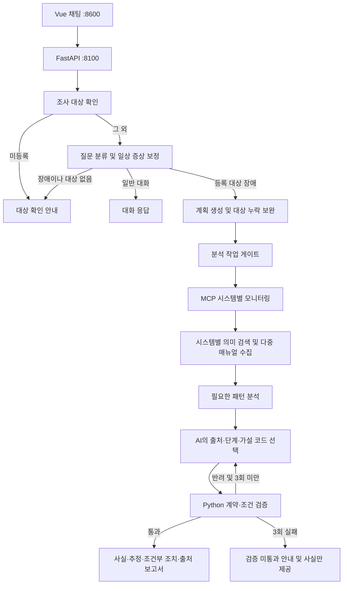

# 운영 장애 에이전트 개선 프로젝트 보고서

작성·검증 기준일: 2026-10-20
저장소: [J5-K/incident-agent-improvement](https://github.com/J5-K/incident-agent-improvement)
대상: 제공된 `all_total_vue_student`의 LangGraph v2 개선

> 이 파일이 프로젝트의 현재 상태를 관리하는 통합 문서다. 구현·평가가 바뀌면 해당 절을 갱신한다. 캡처·JSON·CSV는 당시 실행의 원본 증거로 보존하며, 이 보고서의 설명과 구분한다.

## 1. 개요와 개발 목표

운영 장애 에이전트는 사용자의 질문을 분류하고, MCP로 모니터링 정보와 대응 매뉴얼(RunBook)을 수집해 진단과 대응 방법을 안내하는 교육용 서비스다.

개선 전에는 일상적인 증상 표현을 일반 대화로 처리하거나, 여러 시스템 중 일부만 조사하거나, 미등록 시스템 대신 다른 시스템을 조사하는 문제가 관찰됐다. 첫 개선 후에는 수집된 수치가 조치 조건에 못 미치는데도 조치를 권고하는 문제가 추가로 발견됐다.

목표는 **요청한 대상을 빠짐없이 조사하고, 확인된 수치와 매뉴얼 적용 조건을 보존하며, 검증되지 않은 제안을 최종 권고로 내보내지 않는 것**이다. 실제 운영 장애의 원인을 자동 확정하거나 운영 조치를 실행하는 서비스까지 구현한 것은 아니다.

## 2. 제공 코드와 직접 구현한 내용

| 구분 | 내용 |
|---|---|
| 제공 코드 | FastAPI·LangGraph 파이프라인, Vue 3 채팅, SSE, MCP Tool·Resource·Prompt 및 서버 탐색, SQLite 대화 저장, fake/ollama/openai 백엔드, v1 전환, LangSmith 추적 |
| 직접 개선 | 미등록·미지정 대상 확인, 복수 대상 계획 보완 및 시스템별 매뉴얼 연결, 일상 증상 분류 보완 |
| 직접 추가 | 출처·단계·수치 조건 계약 검증, 사실/추정/조건부 조치 보고서, 고정 데이터 버전 비교 평가, 조회 작업별 부분 실패 대응, RAG 다중 Runbook 검색, 전후 검증 증거 |
| 적용 범위 | 기본 v2 그래프. v1은 기존 교육용 흐름을 유지 |

## 3. 구조와 처리 흐름



MCP Tool `get_monitoring_status`는 교육용 지표를 반환하고, Resource는 장애 대응 매뉴얼 원문, Prompt는 표준 조사 절차를 제공한다. MCP Tool·Resource·Prompt 구조는 유지하고, 매뉴얼 선택에 로컬 임베딩 기반 RAG를 추가했다.

모니터링 수치는 샘플 데이터에 무작위 변동을 더한다. 경고 문구는 고정되어 현재 수치와 다를 수 있다. 실제 운영 데이터·시계열·배포 이력을 수집한 것으로 해석하면 안 된다.

## 4. 문제별 개선 설계

### 4.1 조사 대상 확인

`agent/targets.py`가 `data/monitoring.json`의 등록 목록과 질문의 명시적 이름을 대조한다. 경계·대소문자를 고려하고, 유효한 대상이 없다고 기본 서비스를 반환하지 않는다. `nodes/targeting.py`의 MCP Prompt 대상 추출도 유효한 대상 없이 진행하지 않는다.

- 미등록 이름이 있으면 LLM/MCP 조사 없이 정확한 이름을 요청한다.
- 등록·미등록 이름이 섞여도 일부만 조사하지 않고 전체 확인을 요청한다.
- 대상 없는 질문이 incident로 분류되면 대상 이름을 되묻는다.
- `-service`/`_service`, `web-01` 형태 및 정확한 등록 이름을 지원한다. 별칭·대명사·이전 대화에서의 대상 복원, 모든 미등록 표기법을 지원하지 않는다.
- 등록 목록은 모듈 로드 시 읽으므로 변경 후 서버 재시작이 필요하다.

### 4.2 복수 시스템 조사와 매뉴얼 연결

`agent/planning.py`가 요청한 등록 시스템을 기준으로 모델의 계획을 보완한다. 빠진 대상을 추가하고 중복·요청하지 않은 조사 대상을 제거한다. 분석 작업은 기존 gate의 판단을 따른다.

시스템마다 모니터링과 알림을 따로 처리하고, 누락된 매뉴얼을 최대 한 번의 재조사 라운드에서 수집한다. 수집 데이터·진행 이벤트에 대상 이름을 기록하고, 매뉴얼에는 출처 ID·Resource URI·MCP 서버를 부착한다.

같은 장애의 여러 시스템도 매뉴얼을 각각 조회하므로 호출 수와 답변 길이가 늘 수 있다. 현재 기본 서버는 RAG로 여러 매뉴얼을 선택한다(4.8절). 키워드·db-down 기본값은 명시적 비교 모드에만 남기며, RAG 오류나 검색 무결과 때 사용하지 않는다. 암묵적 연관 시스템 탐색은 지원하지 않는다.

초기에는 최종 답변에 빠진 대상의 근거를 덧붙였지만, 현재는 구조화 계약에 전체 대상이 정확히 한 번 포함되는지 검사한다. 반복 실패 시 제안을 제외하는 방식으로 대체했다. 지표·매뉴얼 조회 실패는 현재 작업별로 격리해 성공 결과와 실패 대상을 함께 보고한다(4.7절).

### 4.3 일상적인 장애 표현 분류 보완

`agent/routing.py`가 모델의 chat 판단에 제한적인 보정 규칙을 적용한다. 등록 시스템 이름과 “프로세서가 바쁘다”, “처리가 밀린다”, “메모리를 더 먹는다” 같은 증상 또는 상태 조회 표현이 함께 있으면 incident로 승격한다.

모델의 원래 분류와 보정 이유는 `RouteDecided`에 남기고 호출 비용 누적도 유지한다. 시스템 이름만 언급한 문장이나 개념 질문은 이 규칙으로 승격하지 않는다. 정규식이므로 새로운 동의어·부정문·인용문을 완벽하게 이해하지 못하며, 대상 이름 없는 chat 오분류도 보정하지 않는다.

### 4.4 수치·조치 조건 검증

`agent/evidence.py`는 자유 서술 초안 대신 아래 항목으로 구성한 JSON 제안을 검증한다.

- 요청 시스템 이름과 모니터링 출처 ID
- 제한된 원인 가설 코드
- 실제 수집한 매뉴얼 출처 ID·단계 번호
- Python이 계산한 조건 상태

수치와 조치 원문은 코드가 수집 데이터에서 직접 출력한다. 모델이 자유 수치·문장을 추가하거나, 다른 시스템 출처·없는 단계·잘못된 조건 상태를 선택하면 반려한다. 현재 검토한 자동 수치 정책은 다음 두 가지다.

| 조치 | 코드 조건 | 경계 및 추가 조건 |
|---|---|---|
| CPU 증설, cpu-spike 3단계 | `cpu_percent > 90` | 90은 미충족. 90 초과여도 지속 여부 미수집이면 추가 확인 전 보류 |
| 메모리 재시작, memory-leak 2단계 | `memory_percent >= 90` | 90은 수치 조건 충족. 수치 충족은 실행 승인이나 실제 재시작을 뜻하지 않음 |

`data/action_policies.json`은 정책과 매뉴얼 원문 SHA-256을 연결한다. 원문이 바뀌면 정책 재검토가 필요하다고 표시한다. 값 누락·문자열·불리언·NaN·무한대는 판단 불가이며, 나머지 단계는 선행 조건과 운영자 확인이 필요하다.

작성·검증은 최대 3회다. **반복 실패를 강제 합격으로 처리하던 동작을 제거**했다. 실패 시 미검증 원인·조치를 제외하고 관측 사실·참고 출처·반려 사유만 제공한다.

### 4.5 근거가 구분된 최종 보고서

`agent/reporting.py`가 다음 순서로 최종 응답을 만든다.

1. 확인된 사실: 시스템 상태·현재 CPU·메모리와 모니터링 출처
2. 원인 추정: 제한된 가설 코드에 대응하는 가능성 문장, 원인 미확정 표시
3. 권장 점검·조건부 조치: 매뉴얼 원문, 적용 상태, 충족 여부와 추가 확인 사항
4. 참고 출처: Tool 이름, 시스템명, Resource URI·서버. 내부 JSON에는 매뉴얼 해시도 저장

고정 경고는 현재 측정값과 분리하고 시점 미확인임을 표시한다. 모델이 특정 단계를 선택하지 않아도 두 검토 정책의 수치 조건은 별도로 보여준다.

`/chat` 응답의 `metadata.report`에 구조화 보고서를 제공하고, Vue에는 검증 범위·출처 수·작성 횟수를 표시한다. 미검증 JSON 초안은 답변 토큰으로 노출하지 않고, SSE 조사·검증 진행 이벤트와 최종 보고서를 제공한다. 일반 대화의 스트리밍은 유지한다.

자유 서술의 폭은 줄지만 수치·출처·조건을 코드로 보존할 수 있다. 이 검증이 원인 가설의 진실성을 보증하거나 LLM-as-a-Judge를 대신하는 것은 아니다.

### 4.6 Graph 노드 모듈 분리

기존 `graph.py` 한 파일에 모여 있던 노드 함수를 `agent/nodes/` 아래 역할별 모듈로 이동했다. `graph.py`는 그래프 생성·의존성 주입·노드 간 연결과 분기만 담당하며 391줄에서 70줄로 줄었다.

| 모듈 | 담당 노드·기능 |
|---|---|
| `nodes/targeting.py` | 등록 대상 확인, 대상 확인 질문, 계획용 대상 추출 |
| `nodes/routing.py` | 질문 분류·보정, 일반 대화 응답 |
| `nodes/planning.py` | 조사 계획 보완, 분석 작업 게이트 |
| `nodes/research.py` | MCP 조사, 시스템별 RAG 다중 매뉴얼 선택·원문 해시 대조·실패 격리 |
| `nodes/analysis.py` | 필요한 경우 패턴 분석 |
| `nodes/writing.py` | AI 제안 작성, 검증, 최종 보고서 생성 |
| `state.py` | 공유 AgentState와 비용 누적 함수 |

노드 이름·조건 분기·호출 순서·LangSmith 추적 이름·SupervisorDeps 주입은 유지한다. 기존 `agent.graph`에서 가져오던 노드와 대상 추출 함수도 재노출해 서버·테스트의 import를 유지했다. 전문 서브그래프나 새로운 멀티 에이전트를 구현한 것이 아니라 **기존 노드 구현의 모듈화**다.

이동 전후 20개 함수·상태 클래스의 AST(코드 구문 구조)를 비교했고, 기존 46개 자동 테스트가 통과했다. 분리 전 커밋과 분리 후 작업 트리에 고정 시나리오 15개를 실행해 답변·구조화 보고서·진행 이벤트·도구 호출·판정이 동일한지 확인했다(실행 시간 제외). 실제 모델 재검증을 추가 실행한 결과는 아니다.

### 4.7 조회 작업별 부분 실패 대응

기존에는 `asyncio.gather` 중 하나가 실패하면 조사 단계가 예외로 끝나 성공한 자료도 응답에 사용하지 못했다. 현재 `nodes/research.py`는 각 작업 결과와 예외를 함께 받아 성공한 결과는 `collected`에 보존하고 실패한 작업은 `failed` 상태와 `collection_failures`로 기록한다. 원시 예외 메시지는 노출하지 않고 대상·자료 종류·오류 유형과 고정 안내 문구만 기록한다.

- 일부 모니터링 실패: 성공한 시스템은 매뉴얼까지 수집하고 실패 시스템은 근거 없이 매뉴얼을 선택하지 않는다.
- 일부 매뉴얼 실패: 이미 수집한 모든 모니터링과 성공한 매뉴얼 출처를 보존한다.
- 매뉴얼 서버 탐색 실패: 해당 매뉴얼 작업별 실패로 기록하고 앞서 얻은 모니터링은 보존한다.
- 전체 모니터링 실패: 자료가 없음을 명시하며 정상 상태로 추정하지 않는다.
- 재시도 가능한 타임아웃은 기존 재시도를 유지한다. 소진되면 작업 실패로 기록한다. 취소 신호는 일반 조회 실패로 바꾸지 않고 전파한다.
- 실패 대상을 재조사 대상으로 계속 추가하지 않고 수집 종료 분기로 이동한다. 성공 여부와 수집 종료 상태는 구분한다.

보수적인 정책으로 **자료 수집 실패가 하나라도 있으면 전체 요청의 AI 원인·조치 생성과 제안 검증을 생략**한다. 성공한 자료의 사실·출처, 실패 대상과 분석 한계만 보고한다. 따라서 성공한 시스템에 대한 AI 권고안도 제공하지 않는 절충이 있다. 작성 횟수 0회와 검증 미수행을 표시하고, 검증 통과로 위장하지 않는다.

보고서의 `collection.status`는 complete / partial / failed로 구분한다. API metadata와 SSE TaskFailed·DraftSkipped·ReportReady 및 Vue 문구에도 실패 상태를 반영한다. 계획 생성에 사용하는 MCP Prompt 조회, LLM 호출, 사용자 연결 끊김·재접속 복원 등은 이번 작업별 실패 격리의 범위가 아니다. 자동 운영 조치나 재개 기능도 없다.

### 4.8 RAG 기반 다중 Runbook 검색

검색 범위는 기존 `data/runbooks/`의 6개 원문이며 파일 내용은 변경하지 않았다. `agent/runbook_search.py`가 문서 제목·본문을 로컬 Ollama `embeddinggemma:latest`로 임베딩하고 코사인 유사도로 문서를 선택한다. 검색된 매뉴얼을 MCP Resource에서 읽어 AI 제안의 근거로 전달하므로 검색과 생성이 연결된 RAG 흐름이다.

소규모 6문서이므로 별도 벡터 DB 서버 대신 JSON 벡터 인덱스와 메모리 내 완전 탐색을 사용한다. 원문 전체가 짧아 한 문서를 한 단위로 임베딩한다. 문서 ID·장애 유형·원문 해시와 임베딩 모델 digest·입력 접두사 버전으로 인덱스를 식별하고, 문서 또는 모델 식별이 달라지면 다시 만든다. 모델 digest는 검색기 초기 사용 시 확인하므로 모델 파일을 교체하면 서버를 재시작한다. 입력 자동 잘림을 끄고 과도하게 긴 입력은 오류로 처리한다. 동시 최초 생성은 잠금으로 한 번만 수행한다.

- 검색 입력: 시스템별 질문 구간과 해당 시스템의 상태·알림. 여러 시스템의 질문을 각 대상 구간으로 분리해 다른 대상의 증상 혼입을 줄인다. 복잡한 자연어의 대명사·공유 구문까지 완벽하게 해석하지는 못한다.
- 선택 정책: 최대 2문서(2026-10-21 변경; 기존 평가 당시 3개), 최소 유사도 0.43, 최고 점수와의 차이 0.08 이내. 개발 질문 8개에서 분포를 확인해 정했고 별도 평가 9개를 본 뒤 임계값을 재조정하지 않았다. 유사도는 정답 확률이 아니다.
- 무결과: 적합한 문서가 없으면 `insufficient`로 표시하고 기본 매뉴얼을 선택하지 않는다. 확보한 사실과 매뉴얼 근거 부족 안내만 제공한다.
- 실패: 임베딩 API·인덱스 생성·검색 오류는 `runbook_search` 실패로 기존 부분 실패 보고서에 연결한다. 키워드로 자동 대체하지 않는다.
- 원문 검증: 검색 인덱스의 문서 해시와 MCP에서 읽은 원문 해시를 비교한다. 다르면 해당 자료는 제외하고 매뉴얼 조회 실패로 처리한다.
- 다중 문서 검증: 같은 시스템에 여러 문서가 있어도 출처 ID가 충돌하지 않는다. 검색된 모든 매뉴얼마다 최소 한 단계가 AI 제안에 있어야 통과한다. 수치 정책도 매뉴얼별로 적용한다.
- UI·보고서: 시스템별 선택 문서와 유사도, 관련 문서 없음 또는 검색 오류, 실제 Tool/Resource 출처를 표시한다.

서버 기본은 `RUNBOOK_SEARCH_MODE=rag`다. `keyword`는 이전 방식 비교를 위한 명시적 모드이며 RAG의 실패 시 폴백이 아니다. 기존 네트워크 없는 테스트/평가의 retriever 미주입도 키워드 비교 경로를 사용한다. RAG 통합 검사는 별도로 검색 의존성을 주입하므로 과거 그래프 평가를 새 RAG 정확도 평가로 해석하지 않는다.

인덱스 캐시는 `data/.cache/runbooks-index.json`에 두고 Git에서 제외한다. `.env.example`에 모델·임계값·문서 수 설정을 기록했고 실제 `.env`의 비밀 값은 변경하지 않았다. 새 환경에서는 `ollama pull embeddinggemma`가 필요하며 원격 유료 API는 사용하지 않는다.

구현 근거: [Ollama Embeddings API](https://docs.ollama.com/api/embed), [EmbeddingGemma 모델](https://ollama.com/library/embeddinggemma), [Google 모델 카드의 검색 접두사](https://huggingface.co/google/embeddinggemma-300m#prompt-instructions).

## 5. 검증 방법과 판정 기준

| 검증 | 범위 | 해석 |
|---|---|---|
| 단위·그래프 테스트 | 대상 추출, 계획 보완, 분류, 조건 경계, 계약 오류, 반복 실패, 보고서·집계 | 네트워크 없는 회귀 검사 69개 통과 |
| 1차 실제 Vue 검증 | f3836e2, 기존 질문 10개, 실제 Ollama | 10개 최종 답변 확보. 실행 완료와 의미적 정확성은 별개 |
| 최신 실제 Vue 검증 | 4d518cb, 오류가 있었던 04·06 재검증 | 새 계약과 보고서 동작 확인. 전체 10개 최신 모델 정확도 평가가 아님 |
| 고정 데이터 자동 평가 | 3개 Git 버전, 고정 질문·지표·매뉴얼 15개 | fake/mock 그래프 비교. 실제 모델 정확도·지연시간 개선율이 아님 |

테스트 통과는 명시된 규칙과 시나리오의 통과다. AI 답변 전체·원인 추정·실제 운영 조치의 정확성을 보증하지 않는다. OpenAI 실 API 백엔드는 이번 실제 모델 검증에 사용하지 않았다.

### 5.1 개선 전·1차 개선 후 사례

개선 전은 기준 `2c2973d`, 1차 개선 후는 `f3836e2`다. 개선 전 01·10은 사용자 제공 캡처, 08·09는 사용자가 교체한 완료 캡처이며 나머지는 Vue에서 수집했다. 08·09 전사 기록을 새로운 자동 원시 로그로 가장하지 않았다.

| 번호 | 질문 요지 | 개선 전 | 1차 개선 후 |
|---|---|---|---|
| 01 | payments CPU 급증 | CPU 매뉴얼 조회·응답 | 동일 조사 경로 완료 |
| 02 | 프로세서가 바쁘고 처리 밀림 | 일반 대화 오분류 | CPU 조사·매뉴얼 연결. 단계 인용 등 품질 한계 있음 |
| 03 | cache 메모리 증가 | 메모리 매뉴얼 조회 | 동일 조사 경로 완료 |
| 04 | 메모리를 더 먹음 | 메모리 매뉴얼 조회, 근거 불명확 표현 | 88.8%인데 >=90 재시작 조건 적용 오류 발견 |
| 05 | 로그 저장 공간 부족 | 디스크 매뉴얼 조회 | 실제 Ollama에서 동일 조사 완료 |
| 06 | gateway→payments 타임아웃 | gateway만 조사 | 두 시스템·두 매뉴얼 수집. 88.4%를 90% 초과로 판단하는 오류 발견 |
| 07 | auth 로그인 응답 지연 | 지연 매뉴얼 조회 | 동일 조사 경로 완료 |
| 08 | payments·cache 각각 확인 | cache 조사 누락 | 두 시스템·CPU/메모리 매뉴얼 및 답변 확보 |
| 09 | 미등록 billing | auth로 임의 대체 | 미등록 확인 안내. 대체 조사 과정 없음 |
| 10 | 인사·자기소개 | 일반 대화 | 일반 대화 유지. 한국어 표현이 다소 어색함 |

현재 CPU와 고정 경고값의 차이, 원인 추정의 타당성도 별도 주의사항으로 기록했다. 세부 원본은 [1차 결과표](after/테스트결과표.csv), [화면 기록](after/화면기록.json)에 있다. 초기 서버 전환 중 Ollama 연결 실패가 한 번 있었고, 복구 후 01부터 독립 대화로 재실행한 완료 결과를 저장했다. 정밀 지연·비용은 측정하지 않았다.

대표 증거:

- [02 개선 전](before/02_CPU다른표현_일반대화오분류.png) / [02 1차 개선 후](<after/02_다른 표현_완료.jpg>)
- [08 개선 전](before/08_복수시스템_cache조사누락_완료.png) / [08 조사 보완 과정](after/08_여러시스템_실행과정.jpg)
- [09 개선 전](before/09_미등록시스템_auth로대체_완료.png) / [09 개선 후](<after/09_미등록 시스템_완료.jpg>)

### 5.2 수치·보고서 개선 후 실제 모델 재검증

Ollama fast `qwen3:0.6b`, quality `qwen3:8b`, 최신 v2 서버에서 매번 새 대화로 실행했다. 코드 기준은 `4d518cb`다.

| 질문 | 현재 측정값 | 작성·검증 | 최종 보고서에서 확인한 동작 |
|---|---|---|---|
| 04 메모리 일상 표현 | 메모리 90.8% | 1회 작성 통과 | >=90 수치 충족과 운영자 승인 필요를 구분 |
| 06 두 서비스 타임아웃 | payments CPU 90.3% | 첫 반려 후 2회 작성 통과 | >90 수치는 충족하나 지속 여부 미수집으로 조치 보류. 4개 출처 표시 |

실제 모델의 무작위 측정값은 이전 88.4/88.8과 다르다. 해당 낮은 값에서 조치를 보류하는지는 고정 데이터로 별도 검증했다. 캡처의 수치를 수정하지 않았다.

[04 실제 보고서](after/v2_grounded/04_보고서.jpg) · [04 전체 화면 텍스트](after/v2_grounded/04_화면내용.txt) · [06 전체 화면 텍스트](after/v2_grounded/06_화면내용.txt)

아래는 실제 06번의 조건 판정 화면이다. 긴 채팅이므로 실행과정·보고서 캡처와 전체 텍스트를 함께 본다.


### 5.3 고정 데이터 자동 평가

`evaluation/fixtures.json`은 기존 질문 10개 + CPU/메모리 경계값 2개 + 오류 초안 주입 2개 + 도구 실패 1개를 고정했다. 지표와 매뉴얼 원문도 같은 파일에 포함한다. `evaluation/run.py`는 `git archive`로 버전을 임시 폴더에 분리하고 별도 Python 프로세스로 그래프를 실행한다. 개발 파일이나 checkout을 바꾸지 않는다.

결과에는 전체 commit, fixture SHA-256, 개별 호출·출처·답변·예외·시간을 저장한다. 아래는 저장된 평가 실행의 집계이며 이후 HEAD가 이동해도 당시 결과는 내부 commit으로 구분한다.

| 평가 항목 | 원래 기준 2c2973d | 1차 개선 f3836e2 | 수치·보고서 개선 4d518cb |
|---|---:|---:|---:|
| 경로 일치 | 6/14 | 13/14 | 13/14 |
| 요청 대상 집합 일치 | 2/14 | 13/14 | 13/14 |
| 시스템별 매뉴얼 연결 일치 | 0/12 | 11/12 | 11/12 |
| 구조화 CPU·메모리 일치 | 미측정 | 미측정 | 11/11 사례 |
| 주입 오류 문장의 최종 노출 | 2/2 | 2/2 | 0/2 |
| 최종 응답 완료 | 14/15 | 14/15 | 14/15 |
| 도구 실패 시 예외 관측 | 1/1 | 1/1 | 1/1 |

판정과 한계:

- 경로·대상 일치는 도구 실패 주입 사례를 제외한 14개를 대상으로 한다.
- 매뉴얼 일치는 매뉴얼이 필요한 12개에서 **대상과 출처 연결까지** 요구한다. 구버전의 0/12는 관련 매뉴얼이 모두 틀렸다는 뜻이 아니라 시스템 연결 정보가 없어서 이 기준을 통과하지 못한 것이다. 의미 검색 정확도나 recall이 아니다.
- 수치 일치는 구조화 보고서의 현재 CPU·메모리 필드와 fixture를 비교한다. 이전 자유 문장은 같은 지표를 측정하지 않았으므로 미측정이며 0점으로 처리하지 않는다. 단위는 보고서 사례 11개다.
- 오류 주입 2개는 “CPU 88.4%를 90% 초과”, “메모리 88.8%가 90% 이상”이라는 명백한 잘못을 강제로 넣었다. 새 버전은 계약 검증 후 미검증 제안을 최종 답변에서 제외했다.
- 새 버전에서도 05번 저장 공간 부족 표현을 fake 라우터가 chat으로 처리했다. 실제 Ollama에서 이전 05번이 성공한 결과와 혼합하지 않는다.
- 위 표의 4d518cb까지는 도구 실패가 전체 요청 예외로 남았다. 이 과거 증거를 수정하지 않고 부분 실패 개선 후 결과는 5.4절에 별도 기록했다.
- fake 작성기도 계약 변경에 맞게 달라졌으므로 버전 차이를 실제 LLM 정확도 향상률로 해석할 수 없다. 실행 시간은 스텁과 교육용 고정 지연을 포함한다. 실제 Ollama 속도 개선율을 주장하지 않는다.

[집계 CSV](evaluation/comparison.csv) · [전체 비교 JSON](evaluation/comparison.json) · [최신 평가 원본](evaluation/HEAD.json)

`HEAD.json`의 저장된 그래프 commit은 **4d518cb**다. 현재 Git HEAD와 같은 뜻으로 읽지 않는다. 평가 재실행 시 파일의 내부 commit·fixture SHA와 함께 이 절을 갱신한다.

### 5.4 부분 실패 개선 후 검증

기존 46개에 작업 실패 8개·평가 집계 1개를 추가해 **전체 55개 테스트 통과**. 모니터링 일부/전체 실패, 매뉴얼 일부 실패, Resource 탐색 실패, 타임아웃 회복/소진, 취소 전파, SSE 실패·성공 이벤트와 최종 보고서를 확인했다.

같은 15개 고정 시나리오를 노드 분리 완료 커밋 `d1fe9cb`와 부분 실패 개선 작업 트리에 실행했다. 실패 주입 15번은 기존의 요청 예외 대신 자료 없음과 실패 대상이 포함된 보고서를 반환했다. 결과는 [부분 실패 비교 원본](evaluation/partial_failure.json)에 보존한다. 작업 트리 검증임을 원본에 명시하며 실제 모델·UI 검증 결과로 표현하지 않는다.

| 항목 | d1fe9cb | 부분 실패 개선 |
|---|---:|---:|
| 15개 최종 응답 완료 | 14/15 | 15/15 |
| 실패 주입 1개에서 실패 안내 보고서 반환 | 0/1 | 1/1 |
| 실패 주입 1개에서 처리되지 않은 요청 예외 | 1/1 | 0/1 |

위 실패 주입 사례는 단일 대상 전체 실패이므로 성공 자료 보존 자체의 근거는 아니다. 성공 자료 보존은 복수 시스템 중 일부 모니터링/매뉴얼이 실패하는 별도 통합 테스트로 확인했다. 정상 자료 경로와 기존 수치·출처 검증도 전체 테스트로 확인했다. 실패 안내 응답을 정상적인 장애 진단 성공으로 간주하지 않는다.

### 5.5 RAG 검색 및 통합 검증

전체 자동 테스트 **69개 통과**. RAG 전용 14개는 단일·복합·무결과 선택, 캐시 재사용·문서 변경·캐시 손상, 동시 생성, 잘못된 벡터·차원, 시스템별 질문 분리, 임베딩 실패, 다중 매뉴얼 제안 누락, MCP 원문 불일치와 부분 실패 보존을 검사한다. 합성 벡터 테스트는 로직 검증이며 의미 이해 성능의 증거가 아니다.

[검색 질문](../evaluation/rag_cases.json)은 구현 전에 기대 매뉴얼을 정한 개발 8개·평가 9개다. [실제 임베딩 평가 원본](evaluation/rag_retrieval.json)은 로컬 임베딩 모델을 실행한 결과이며 전체 순위·점수·설정·모델 digest·문서/질문 해시와 시간을 보존한다.

| 별도 평가 질문 9개 지표 | 기존 키워드 선택 | RAG |
|---|---:|---:|
| 기대 문서 집합 정확히 일치 | 1/9 | 6/9 |
| 문서 micro precision | 11.1% | 100% |
| 문서 micro recall | 12.5% | 62.5% |
| 관련 문서 없음 구분 | 0/2 | 2/2 |

개발 세트는 8/8 일치했지만 별도 평가에서는 메모리·지연·네트워크를 일상적으로 표현한 3개가 임계값에 못 미쳐 무결과가 됐다. 잘못된 문서 선택을 줄이는 대신 누락이 생기는 절충이며, 문서가 없다는 안내를 진단 성공으로 간주하지 않는다. 복합 증상 평가에서는 CPU/메모리 문서를 둘 다 선택했다.

비교는 같은 검색 문장을 기존 키워드 분류기의 단일 alert 문자열로도 넣어 수행했다. 실제 운영 모니터링 전체 입력을 비교한 실험이나 모델 답변 정확도 비교가 아니다. 소규모 수작업 질문이므로 일반화 성능을 보증하지 않는다. 문서 검색 시간은 로컬 임베딩 호출을 포함하고 키워드 검사보다 추가 비용·지연이 있다.

실제 MCP·임베딩·작성 모델 대표 검증과 전체 최신 Vue 재검증은 구분해 기록한다. 최신 전체 질문 10개의 Vue 검증은 최종 검증 단계에서 별도로 수행해야 한다.

## 6. 코드 변경 위치와 커밋

| 파일 | 직접 변경한 역할 |
|---|---|
| `agent/targets.py` | 등록 대상 추출·대조, 임의 기본값 방지 |
| `agent/planning.py` | 명시한 대상 기준 계획 보완·중복 및 임의 대상 제거 |
| `agent/routing.py` | 일상 증상 chat 오분류 보정 |
| `agent/graph.py` | 그래프 생성·노드 연결·조건 분기·의존성 주입 |
| `agent/nodes/targeting.py`, `routing.py`, `planning.py` | 대상 확인·질문 분류·계획 보완·게이트 노드 구현 |
| `agent/nodes/research.py`, `analysis.py`, `writing.py` | MCP 조사·재조사·분석·작성·검증·최종화 노드 구현 |
| `agent/state.py` | 공유 상태와 비용 누적 |
| `agent/evidence.py` | 출처 인덱스, 조건 계산, 제안 JSON 계약 검사 |
| `data/action_policies.json` | 검토한 두 수치 조건·매뉴얼 원문 해시 |
| `agent/reporting.py` | 사실·추정·조건부 조치·출처와 검색 상태·근거 부족 안내 생성 |
| `agent/runbook_search.py` | 로컬 임베딩, 모델/문서 해시 기반 인덱스, 유사도 다중 검색, 시스템별 검색 입력 |
| `agent/fake_llm.py`, `agent/ollama_llm.py`, `agent/openai_llm.py` | 자유 문장 대신 출처·단계·가설 코드 선택 |
| `server.py`, `web_chat.html` | 응답 metadata 보고서·조회 실패 목록, Vue 진행·검증·부분 실패 상태 표시 |
| `evaluation/run.py`, `evaluation/fixtures.json`, `tests/` | 고정 버전 비교, 조건 경계·출처 위조·재작성 실패 등 검사 |
| `evaluation/run_retrieval.py`, `evaluation/rag_cases.json` | 개발·별도 평가 질문의 실제 임베딩 검색과 키워드 비교 |

| 커밋 | 작업 |
|---|---|
| `2c2973d` | 개선 전 소스·확인된 Vue 증거 기준점 |
| `6691359` | 미등록·미지정 조사 대상 확인 |
| `8d85184` | 복수 시스템 조사·매뉴얼 누락 보완 |
| `f3836e2` | 일상 장애 표현 분류 보완 |
| `26eec66` | 수치 조건·출처 계약 및 실패 시 사실 제공 |
| `4d518cb` | 근거가 구분된 보고서 |
| `d452138` | 고정 데이터 평가·실제 재검증 증거·결과물 정리 |

## 7. 설계의 절충과 남은 한계

- **제한된 자동 판단:** 자동 수치 정책은 CPU 증설·메모리 재시작 두 가지다. 배포 시점·지속 시간 등 미수집 조건이나 다른 단계는 추가 확인을 요구한다.
- **원인 정확성:** 가설 코드를 제한해 위험한 자유 수치 문장은 줄였지만, 어떤 가설이 실제 원인인지는 별도 검증이 필요하다.
- **조사 대상:** 명시된 이름만 처리한다. 별칭·대명사·대화에서의 대상 복원과 조사 재개는 구현하지 않았다.
- **매뉴얼 검색:** RAG의 보수적 임계값으로 일부 표현은 누락된다. 6개 짧은 문서·수작업 질문에 한정되며, 검색 점수는 정답 확률이 아니다. 관련 문서 없음을 오류와 구분하고 근거 부족으로 안내한다.
- **실패·성능:** 조회 작업별 실패는 격리하지만 부분 자료에서는 AI 권고 전체를 보류한다. 계획 Prompt·LLM 오류, 동기 LLM 호출 비동기 전환, 큐·동시 실행 제어와 중단 후 복원은 아직 지원하지 않는다.
- **검증 범위:** LLM-as-a-Judge와 실제 운영 조치의 안전성 평가는 구현하지 않았다. 최신 실모델은 04·06 집중 재검증이며 전체 질문의 반복 실험이 아니다.
- **출력 방식:** 미검증 초안 토큰 노출을 없애 검증 전 생성 문장의 실시간 표시를 줄였다. 진행 이벤트와 검증 후 최종 결과는 제공한다.

## 8. 향후 진행 순서

1. 최신 코드로 질문 10개 전체를 실제 모델에서 반복하고 성공 기준·응답시간 측정 방법을 사전에 고정한다.
2. fake 평가에서 드러난 공간 부족 표현 등 라우팅 회귀를 보완한다.
3. 조건 정책을 확대하려면 실제 수집 필드·시계열과 매뉴얼 버전 관리부터 보완한다.
4. 복합 장애·관련 문서 없음·일부 조회 및 검색 실패를 포함해 실제 MCP/UI 최종 검증과 캡처를 마무리한다.
5. RAG 누락 표현을 개선할 때는 새 개발 데이터로 정책을 조정하고 새로운 평가 세트로 재검증한다. 기존 평가 결과를 덮어써 성능 향상으로 주장하지 않는다.

## 9. 증거 파일과 문서 관리

| 위치 | 보관 내용 | 코드 기준 |
|---|---|---|
| `docs/before/` | 개선 전 캡처 10개·질문·전사·결과표 | 2c2973d |
| `docs/baseline/` | 기존 경로를 유지한 동일 개선 전 증거 | 2c2973d |
| `docs/after/` 최상위 | 1차 개선 캡처 12개·질문별 화면 텍스트 10개·JSON·CSV | f3836e2 |
| `docs/after/v2_grounded/` | 04·06 최신 재검증 캡처 5개·전체 화면 텍스트 2개 | 4d518cb |
| `docs/evaluation/` | 버전별 JSON, comparison JSON·CSV | 각 결과 내부 commit·fixture SHA |
| `doc/README.md` | 제공 코드의 원본 교육 매뉴얼 | 직접 개선 성과와 구분 |

기능별 설명·결과 요약·개선 내역·폴더별 안내는 이 문서로 통합했다. 과거 설명은 Git 이력에서 복원할 수 있다. 캡처·JSON·CSV·화면 텍스트의 관측 내용을 새 결과에 맞춰 덮어쓰지 않는다.

자동 평가는 JSON·CSV만 생성한다. 실행 후 원본을 확인해 이 보고서의 평가 표·코드 기준·한계·향후 작업을 갱신한다. 보고서에 없는 새 성과를 기존 결과로 소급해 주장하지 않는다.

## 10. 실행·재현 및 제출 준비

실행은 저장소 루트 [README](../README.md)를 따른다. 기존 실행 스크립트는 포트 프로세스를 종료하거나 세션 DB를 초기화하므로 대화 보존이 필요하면 주의한다. 검증은 프로젝트 루트에서 실행한다.

```bash
PYTHONDONTWRITEBYTECODE=1 LANGCHAIN_TRACING_V2=false LANGSMITH_TRACING=false .venv/bin/python3 -m unittest discover -s tests -v
PYTHONDONTWRITEBYTECODE=1 LANGCHAIN_TRACING_V2=false LANGSMITH_TRACING=false .venv/bin/python3 evaluation/run.py --refs 2c2973d f3836e2 HEAD
```

실제 임베딩 검색 평가는 `.venv/bin/python3 evaluation/run_retrieval.py`로 재현한다. 개발·평가 구분과 질문·설정을 유지한다.

`--refs WORKTREE`는 미커밋 코드 확인용이며 결과에 명시된다. 평가가 기록한 commit과 현재 구현을 구분한다. 실제 모델 재현은 Ollama 모델·v2 설정을 유지하고 독립 질문마다 Vue 새로고침으로 새 대화를 생성한다.

Graph 노드 분리는 `d1fe9cb`로 기록했고, 부분 실패 대응은 별도 기능 커밋으로 기록한다.

이 파일은 제출 보고서 초안이다. 제출 전 최신 과제 양식에 맞춰 작성자·제출일·분량을 채우고, 최신 전체 실모델 재검증 여부와 저장소 링크를 확인한다. 발표에서는 문제 사례 → 코드 설계 → 전후 증거 → 평가 결과 → 한계 순서로 설명한다. 수치 개선은 이 문서에 정의한 평가 범위 안에서만 사용한다.

### RAG 인계 시점 추가 관찰 (2026-10-20)

실제 MCP·임베딩과 fake 작성기를 연결한 [대표 결과](evaluation/rag_integration.json)에서 복합 증상은 3개 매뉴얼 선택 후 계약 통과했지만, 복수 시스템의 payments 검색은 무결과여서 사실 보고서로 종료했다. 검색 입력·불필요 문서 선택은 추가 개선이 필요하다. 실제 8B 작성은 4분 이상 완료되지 않아 취소했으며 [미완료 기록](evaluation/rag_writer_check.json)을 보존한다. 최신 전체 실모델/Vue 검증을 완료한 것으로 해석하지 않는다. 이어서 할 작업은 [프로젝트 설명서](../doc/README.md)에 기록했다.

### 2026-10-21 보완

검색 입력에서 서비스 식별자·빈 연결 구문·degraded 상태 잡음을 제거하고 최대 검색 수를 2개로 제한했다. Qwen3 호출에 think=false를 추가했다. 자동 회귀 테스트 70개 통과. 과거 검색 평가와 4분 이상 생성 미완료 기록은 보존하며 최신 설정의 성능 증거로 소급하지 않는다. 대표 실모델 재검증은 rag_live_20261021.json을 확인하고, 전체 최신 Vue 검증은 별도로 남긴다. doc/README.md는 인계 메모를 제거하고 현재 프로젝트 설명서로 전면 갱신했다.

2026-10-21 실제 MCP·임베딩·qwen3:0.6b/8b 대표 검사: 복수 시스템·복합 증상 2개 모두 incident 및 계약 검증 통과, 각각 14.76초, 14.97초. 이는 전체 최신 Vue 질문 10개 검증을 대체하지 않는다. 원본: docs/evaluation/rag_live_20261021.json.

검색 품질은 계약 검증 통과와 구분한다. 2026-10-21 복수 시스템 대표 실행에서는 payments의 CPU·지연 매뉴얼과 cache의 메모리 매뉴얼이 선택됐고, 단일 시스템 복합 증상에서는 CPU만 선택돼 기대한 메모리 매뉴얼이 누락됐다. 따라서 복합 증상의 검색 누락·불필요 문서 선택 문제는 아직 완전히 해결되지 않았다.


## 2026-10-21 검색 범위·보고서 화면 보완

이 절은 앞선 대표 실행의 CPU·메모리 복합 검색 누락 및 TLS 요청에 지연 매뉴얼이 선택된 문제에 대한 후속 변경이다. 과거 결과는 당시 기록으로 보존한다.

- 기존 런북 6개 원문은 변경하지 않았다. 명시된 증상을 분리해 각각 임베딩 검색하고 결과를 합친다. 증상과 제외 조건은 현재 6개 런북에 대응하는 표현 규칙으로 추출한다. 문서를 키워드만으로 강제 선택하지 않으며 유사도 기준에 못 미치면 누락으로 기록한다. 최대 2개 설정은 개별 검색 기준이고 최종 합집합은 2개를 넘을 수 있다.
- 명시한 증상 범위 밖의 모니터링 알림이 검색 범위를 바꾸지 않도록 했다. 일반 상태 조사에서만 알림을 보조 검색 입력으로 사용한다. TLS/SSL·인증서 요청은 도구·매뉴얼 미지원으로 표시한다.
- 검색한 증상 일부가 빠지거나 미지원 요청이 섞이면 확보한 출처를 유지하되 원인·조치 생성 및 검증을 생략한다. 검증에도 요청 증상 누락·제외 대응·범위 밖 런북 검사를 추가했다.
- 화면은 상태·원인 판단·우선 확인 사항(최대 3개)을 먼저 표시하고 전체 조치·출처·검색 결과·검증 상세는 접어서 제공한다. 전체 텍스트 응답은 유지한다.
- 진행 단계·경과 시간·45초 이상 지연 안내·재작성 검사 횟수·연결 끊김 안내를 추가했다. 백엔드는 처리 오류를 StreamError 이벤트로 전달하고 600초 비동기 요청 제한을 둔다. 기존 동기 모델 호출은 이벤트 루프를 막을 수 있으므로 이 제한을 모든 정지 상황의 강제 종료로 해석하면 안 된다.

### 후속 검증

- 실제 Ollama 임베딩: 복합 질문에서 cpu-spike+memory-leak, 메모리 단독에서 memory-leak, TLS 제외 요청에서 문서 없음. `docs/evaluation/rag_scope_retrieval_20261021.json`.
- 실제 MCP + qwen3:0.6b/8b: 복합 질문 10.83초, 두 런북 확보·출처 조건 검사 통과. TLS 1.79초, 관련 매뉴얼 없음·인증서 확인 불가·생성 생략. `docs/evaluation/rag_scope_pipeline_20261021.json`.
- 화면은 별도 임시 포트에서 위 실제 결과를 재생해 요약과 상세 접기를 확인했다. 기존 8600 백엔드를 재시작한 전체 UI 종단 검증과는 구분한다.
- 자연어 범위 추출은 제한된 표현 규칙이다. 한 문장 안에서 포함·제외를 교차하는 복잡한 지시, 새로운 증상 표현, 복수 시스템의 공통 서술은 추가 평가가 필요하다. 이번 대표 사례 통과를 전체 검색 정확도로 해석하지 않는다.

적용: 실행 중인 백엔드를 중단하고 다시 실행한 뒤 브라우저를 새로고침한다. Ollama 자체를 재시작할 필요는 없다.

최종 회귀 확인: 자동 테스트 **76개 통과**(추적 전송 비활성화), JavaScript 문법 검사 및 git diff 공백 검사 통과.


## 발표용 최종 실행 증거 (2026-10-21)

최신 화면 문구를 적용한 localhost:8600에서 복합 증상·TLS 제외 요청·미등록·미지정 대상의 대표 4사례를 확인하고 캡처 5장을 저장했다. CPU·메모리 런북 동시 선택, 현재 메모리 54.5%에서 90% 조치 보류, TLS 확인 불가 안내를 확인했다. [발표 자료 및 캡처 목록](presentation/README.md)을 참고한다. 전체 최신 10개 UI 회귀 검증과 구분한다.


## OpenAI 최종 검증 (2026-10-21)

기존 기준 질문 10개를 원문 그대로 OpenAI(gpt-4o-mini/gpt-4o)로 재실행하고 추가 2개와 구분했다. 1차 6·8번에서 발견한 공통 서술 분리 오류와 OpenAI JSON 모드 연결 누락을 수정했다. 최종 기존 10/10, 추가 2/2의 기대 동작을 확인하고 캡처·근거 텍스트·결과표를 저장했다. 자동 테스트 81개 통과. RAG 임베딩은 Ollama이며, 과거 Ollama 실행과 최신 OpenAI 결과를 구분한다. [최종 발표 자료·검증 목록](presentation/openai_final/README.md) 참조. 전체 일반화 정확도·원인 확정·속도 개선율을 뜻하지 않는다.
